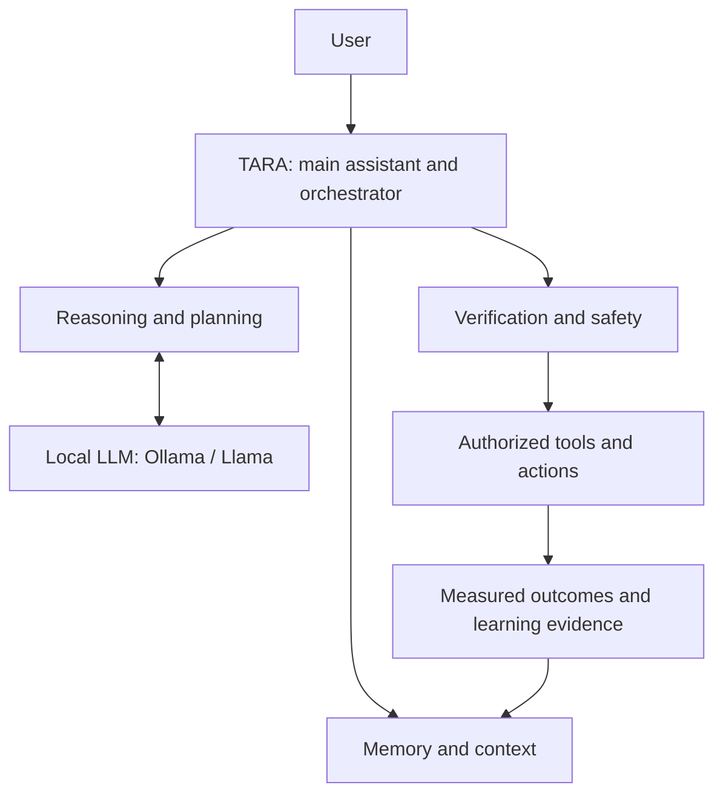
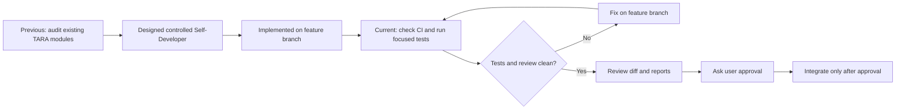
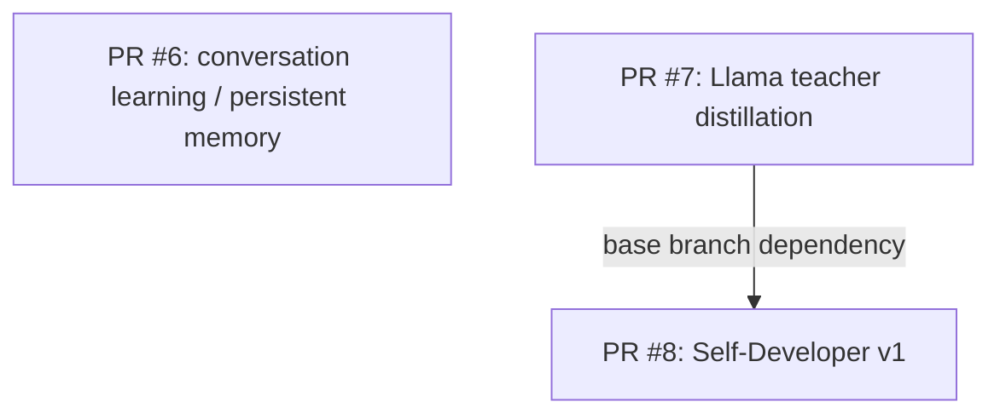
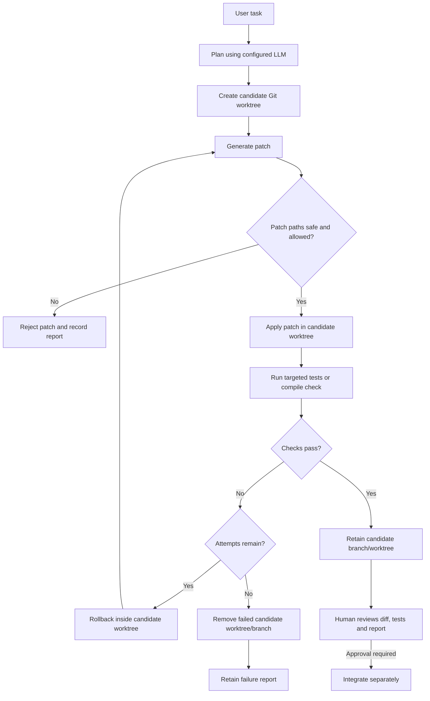
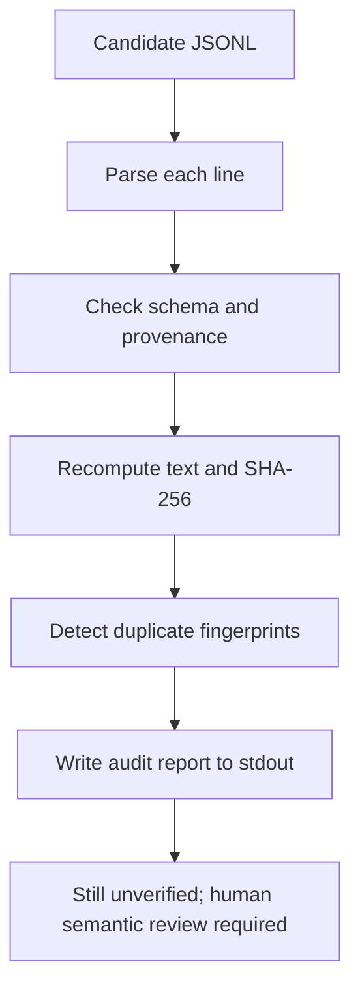
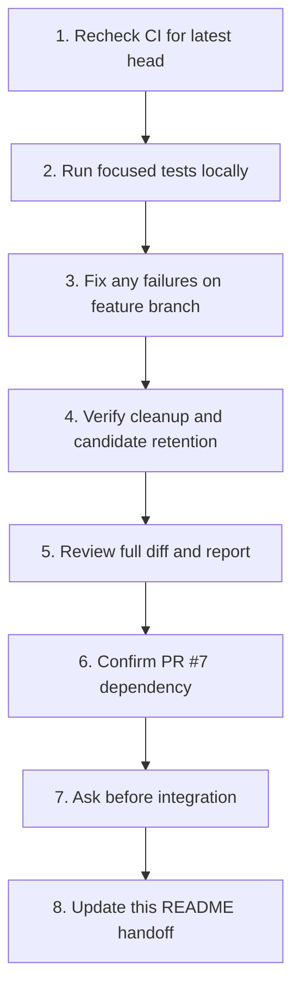
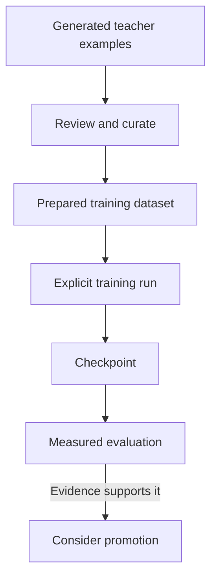

# TARA

**TARA — Tiny Artificial Reasoning Architecture**

TARA is a research-first neural-network project built from mathematical and implementation fundamentals. The goal is a highly capable, inspectable artificial reasoning system that connects a neural language core with perception, memory, structured reasoning, advanced planning, intelligent tools, algorithm discovery, self-improvement, continual learning, reflection, autonomous tasks, scheduling, temporal context and an explicit world model.

## Cross-chat project handoff (update this section after each meaningful task)

> **Last updated:** 2026-10-13  
> **Purpose:** Future ChatGPT chats should read this section first, verify the current GitHub state, and continue from the next action. Keep this section and its diagrams updated after meaningful work.

### 1. TARA at a glance



**Core boundary:** TARA owns the cognitive/orchestration layer. Ollama/Llama supplies language generation and reasoning; it does not replace TARA. Current local model is `llama3.2:3b`, selected with `TARA_LLM_BACKEND=ollama`.

### 2. Previous work → current state → next step



### 3. Current pull-request map



- **PR #6 — conversation learning/memory:** [PR #6 / branch](https://github.com/deathkernel/TARA/tree/feature/tara-conversation-learning). Adds user-approved persistent memory commands. Draft/open and not merged as last reported.
- **PR #7 — teacher distillation:** [PR #7 / branch](https://github.com/deathkernel/TARA/tree/feature/tara-llama-distillation). Generates candidate multi-domain teacher examples with local Ollama. Examples need review; this does **not** train a TARA checkpoint. Draft/open and not merged as last reported.
- **PR #8 — Self-Developer v1:** [review PR #8](https://github.com/deathkernel/TARA/pull/8) · [branch](https://github.com/deathkernel/TARA/tree/feature/tara-self-developer-v1). Based on PR #7's branch; draft/open and not merged as last reported.
  - Self-Developer implementation commit: `198c2050c5b689c976b4edeec35a00a028347f07`.
  - README handoff commits: `ceba5cb002f2af8db8a390b11e5d59e9dd125daa`, `461686de55bfc078181d57b39f6b175b68384043`.
  - Adds `src/self_developer.py`, `src/self_developer_cli.py`, tests, and `docs/tara_self_developer.md`.
  - CLI commands: `status`, `plan`, `run`, `report`.
  - Candidate worktree changes are not committed, pushed, merged, or integrated automatically.

### 4. Self-Developer task lifecycle



**Safety rules**
- Controlled autonomy: code generation and tests may run in a candidate worktree; approval is required before integration.
- A Git worktree is **not** a hostile-code security sandbox. Review generated code and test behavior.
- Self-Developer protects `checkpoints/`, `outputs/`, `data/conversation_v1.jsonl`, `data/conversation_v1.jsonl.manifest.json`, and `test_voice.py`.
- Never run `git clean`, destructive resets, or cleanup against the original user working tree. Preserve local untracked files and data.

### 5. Validation status — do not guess

Latest CI evidence checked on 2026-10-13: runs `38441158044` (run 1067) and `38441158193` (run 1068), associated with rollback test commits `87d4687` and `07a0893`, were **queued**; both reported `python-tests` and `rust-tests` queued. Run `38441003150` (run 1058) for validator follow-up `479a9a0` was also queued. The latest reliability batch `88ba6db` adds apply-check retry and cleanup-warning/report-retention regressions; run `38441408859` (run 1074) still reports both `python-tests` and `rust-tests` as **queued**. The newest patch-guard hardening commits `f3a8c4d` and `7ec2dd6` reject nested `.git` metadata paths; no workflow run or status check was returned for the latest test commit at the time of this update. The current branch head has not been confirmed green, and the branch is **not CI-verified**. No local tests have been run by the assistant.

**Latest batched changes:**
- `ec9112f` + `789b6e2`: fix report consistency; persist `report_path` in the JSON and test returned/saved values.
- `5df5f62` + `fef8e30`: validate `diff --git` header paths, reject file-mode/rename/copy/binary patches, and add regression cases for traversal, symlink-mode, and binary patch attempts.
- `c66a797`: added command-runner regression tests for `shell=False`, timeout propagation, and bounded failure output.
- `c7efb00`: failed Self-Developer runs now attempt to remove only their own generated candidate worktree and `tara-selfdev-*` branch while retaining the JSON report; cleanup warnings are recorded rather than silently discarded.
- `0e2ce86`: validator now checks that `diff --git` paths agree with the corresponding `---`/`+++` markers and blocks Git metadata paths.
- `f3a8c4d` + `7ec2dd6`: hardened the patch gate to reject `.git` metadata in any path component, including nested paths such as `src/.git/config`, with a regression fixture.
- `479a9a0`: diff marker path parsing now strips tab-separated timestamps correctly before comparing header paths.
- `34c837f` + `5639e5b` + `ff95418`: added regression coverage for mismatched diff paths, exact `.git` path rejection, and retaining successful candidates for human review; corrected newline escaping in the new test fixtures.
- `87d4687` + `07a0893`: added a retry regression where a newly added failing test must be rolled back before a second, successful candidate patch; corrected the fixture newline escapes.
- `88ba6db`: added temporary-repository regressions for `git apply --check` failure followed by a clean retry, and for worktree/branch cleanup failures remaining visible in the returned and persisted failure report.
- `518dc65` + `fec9651` + `f32e370`: added failure-path tests for command startup errors, worktree creation failure, bounded retries, provider exceptions, failed candidate cleanup, and unchanged base repository state.
- `f338912` + `862ce83`: added teacher-data checks for reproducible SHA-256 provenance, candidate review labels, short-answer filtering, and preserving an existing dataset when generation fails.
- `71a497d` + `3819ef1` + `f19fd66` + `6c2927d`: added a read-only candidate JSONL audit that checks schema, domains, source/model provenance, review labels, text consistency, SHA-256 fingerprints, duplicate fingerprints, malformed JSON, and blank lines. It always reports `ready_for_training: false`; structural validation cannot prove semantic correctness.
- `4362432`: audit now reports invalid UTF-8 per line instead of crashing on decoding errors.
- `2921bd6` + `ee665d6` + `6f2144e` + `e91f069` + `11f5dcdb` + `f868d43` + `7c0540e9`: added tests for clean audit, tampering, duplicate records, malformed JSON/UTF-8, missing files, CLI exit codes, and JSONL line endings.
- `ef59f33`: removed a duplicate handoff bullet and refreshed the CI caveat.
- These are code/test additions, not passing-test claims. The assistant has **not executed the local test suite**; check CI before treating them as passing.

### Teacher dataset audit — read-only

Generate candidate examples as before, then audit the file without calling Ollama or changing the dataset:

```bat
python -m src.teacher_distillation --audit data/llama_teacher_v1.jsonl
```



Exit code is `0` when every record passes structural/provenance checks, `1` when records are invalid, and missing files raise a clear error. Even a clean audit **never certifies training readiness**; it cannot determine whether a teacher answer is factually correct, safe, or pedagogically useful.

### 6. Next actions — follow in order



**Windows CMD — safe start**

```bat
git fetch origin
git switch --track origin/feature/tara-self-developer-v1
git status --short
```

If the local branch already exists, use `git switch feature/tara-self-developer-v1`. **Read `git status --short` before proceeding** and preserve existing user files.

Run focused tests:

```bat
python -m pytest -q tests/test_self_developer.py tests/test_self_developer_cli.py
python -m src.self_developer_cli status
```

Configure local Ollama for planning in the current CMD window:

```bat
set TARA_LLM_BACKEND=ollama
set TARA_LLAMA_MODEL=llama3.2:3b
python -m src.self_developer_cli plan "Add a regression test for memory retrieval"
```

After reviewing the plan and branch state, a candidate task can be run with:

```bat
python -m src.self_developer_cli run "Add a regression test for memory retrieval"
python -m src.self_developer_cli report
```

### 7. Keep these distinctions clear



- Persistent conversation memory **is not** model-weight training.
- Teacher-generated examples are not automatically correct and are not TARA's raw pretraining corpus.
- A script or provider integration in source code is not proof that training ran, an API authenticated, or a capability was achieved.
- Report only results supported by actual test/CI output or measured evaluation.
- Previous commands for `src.self_developer_cli` failed before the module existed. The module is now on the PR #8 branch; switch to that branch before using the commands above.

### 8. Update protocol for every meaningful task

After a meaningful change, update this section with:
1. **What changed** — files/features and a short explanation.
2. **Where** — branch, commit and PR link.
3. **Evidence** — exact tests/CI run and pass/fail/pending result.
4. **Still pending** — blockers and decisions awaiting user approval.
5. **Next step** — the next command or review action.
6. **Diagrams** — adjust these when architecture, PR dependencies or task flow changes.

Do not mark work as tested or merged until there is evidence. Keep the diagrams useful and simple; add one when it explains a flow better than a paragraph.

---

## Pre-training readiness — complete

The repository now has an explicit readiness gate before the first real training run:

- **PyTorch dependency declared** in `requirements.txt`.
- **Dataset loader + audit** validate the source corpus before training.
- **Context-fit check** verifies that the corpus can produce training sequences for the requested context length.
- **Training configuration validation** checks model and optimization parameters.
- **CPU/CUDA detection** confirms that the selected training backend is available.
- **No training side effects** — the readiness command only checks prerequisites and never creates a checkpoint.

Run the gate first:

```bash
python training_preflight.py --data data/algorithm_tasks.jsonl --context 128
```

A successful preflight means the repository prerequisites are satisfied. It does **not** mean that training has already happened or that the resulting model will be capable; those require an actual training run and measured evaluation.

## Public curriculum dataset pipeline

TARA now has a bounded public-dataset acquisition layer. It streams selected Hugging Face datasets instead of downloading entire multi-terabyte corpora, then applies text-length filtering, deterministic shuffling, cross-source deduplication, provenance/license metadata and a reproducible fingerprint.

The current curriculum manifest is in `data/dataset_sources.json`.

### Basic level

- **FineWeb-Edu** — educational web text for general language and knowledge learning.
- **GSM8K** — mathematical word-problem reasoning.
- **TinyStories** — optional small-language-model warm-up corpus.

### Advanced level

- **FineWeb** — broad English web pretraining data.
- **The Stack v2 Smol** — advanced code data; source licenses and upstream terms must be respected.

Prepare a bounded Basic v1 sample without downloading an entire corpus:

```bash
python prepare_tara_dataset.py --level basic --max-records-per-source 1000 --output data/basic_v1.jsonl
```

The resulting JSONL is directly consumable by the existing training pipeline because each curated record contains a `text` field. The preparation command is an explicit data operation; it does not start model training.

The public source manifest records dataset identity, organization, role and stated licensing information. Downstream use must still follow each upstream dataset's current terms and provenance requirements.

## Phase 37.11 — Single-Command Learning Pipeline Complete

`run_learning_experiment.py` connects baseline evaluation, explicit training, candidate evaluation and evidence-gated promotion into one reproducible workflow.

```bash
python run_learning_experiment.py checkpoints/baseline.pt data/algorithm_tasks.jsonl checkpoints/candidate.pt --steps 100
```

The candidate is accepted only after real evaluation shows strict overall improvement without a permitted category regression. Training is an injected explicit operation; no normal TARA runtime silently starts heavy training.

## Phase 37.10 — Learning Experiment Pipeline Complete

Phase 37.10 adds `src/learning_experiment.py` for baseline/candidate evaluation, capability deltas, checkpoint existence checks, regression protection and experiment fingerprints.

## Phase 37.8 — Real Model Capability Evaluation Complete

Phase 37.8 connects the capability suite to an actual TARA checkpoint instead of only synthetic solvers:

- **Real checkpoint loader** — evaluates checkpoints through the existing model runtime.
- **Deterministic greedy inference** — capability measurements use reproducible decoding rather than sampling noise.
- **21-case capability suite** — coding, reasoning, memory, planning, tool use, algorithms and learning are evaluated separately.
- **Model/evaluation fingerprints** — architecture/tokenizer configuration and benchmark results are traceable.
- **Dedicated CLI** — `evaluate_tara_capabilities.py <checkpoint>` runs the evaluation without training.
- **Core integration** — `TARACore.evaluate_checkpoint(...)` exposes real-model evaluation through the top-level runtime.
- **No promotion side effects** — evaluation is inference-only and cannot silently modify or promote a checkpoint.

Example:

```bash
python evaluate_tara_capabilities.py checkpoints/algorithm_lm.pt --output experiments/tara-capability-baseline.json
```

A missing checkpoint is an execution prerequisite, not a reason to invent a score. The repository therefore reports real capability scores only after an actual checkpoint exists and the evaluation command has run.

## Phase 37.7 — Evidence-Gated Intelligence Improvement Complete

Phase 37.7 closes the measurement-to-improvement loop without pretending that a benchmark failure automatically means a specific training method will fix it:

- **Failure analysis** — failed and partial benchmark cases become explicit capability failures with severity.
- **Targeted planning** — failures are grouped into capability targets with deterministic priority and training hints.
- **Bounded experiment boundary** — an injected candidate runner performs the actual training/evaluation work; the improvement engine itself never silently trains.
- **Regression protection** — candidate results are checked against overall and category-level regression limits.
- **Promotion gate** — a candidate is accepted only when it produces a strict overall improvement and passes the regression gate.
- **Deterministic provenance** — proposal and improvement reports receive SHA-256 fingerprints.
- **Brain integration** — `TARABrain` exposes `benchmark_intelligence`, `propose_intelligence_improvement`, and `improve_intelligence`.

This is an evidence-gated optimization loop, not proof of autonomous intelligence. Actual model improvement still requires an executed training experiment and a benchmark run against the resulting checkpoint.

## Phase 37.6 — Capability Benchmark Suite Complete

Phase 37.6 expands measurement from a four-case smoke test into a multi-capability deterministic suite:

- **Coding** — arithmetic, string transformation and ordering.
- **Reasoning** — transitive reasoning, negation and arithmetic.
- **Memory** — explicit fact/token/sequence recall.
- **Planning** — ordering, dependencies and plan validation.
- **Tool use** — capability selection, verification and emergency-stop behavior.
- **Algorithms** — correctness gates, performance comparison and regression rejection.
- **Learning** — replay/forgetting, evidence gating and improvement validation.
- **Regression-safe scoring** — the existing benchmark engine keeps category-level and overall regression gates explicit.

The suite evaluates an injected solver; it does not execute arbitrary model output or grant permissions. A perfect synthetic solver test demonstrates benchmark mechanics, not that TARA itself has achieved those capabilities.

## Phase 37.5 — Auditable Training Experiments Complete

Phase 37.5 turns training into an explicit, reproducible experiment boundary:

- **Dataset preflight** — training is blocked when the dataset audit reports error-level split overlap.
- **Stable experiment identity** — dataset fingerprint + complete training configuration produce a deterministic experiment ID.
- **Training handoff** — the runner delegates to the hardened PyTorch pipeline with accumulation, scheduler, early stopping and checkpoints.
- **Manifest output** — dataset/audit fingerprints, checkpoint, metrics, steps, losses, device and configuration are persisted as JSON.
- **Dedicated CLI** — `run_training_experiment.py` exposes the complete experiment workflow without silently training during runtime.
- **Model controls** — the existing trainer exposes depth, dropout, weight tying and all Phase 37.3 optimization controls.

Actual model training remains an explicit offline operation. Repository code does not claim a trained model until a training command has actually executed and produced a checkpoint.

## Phase 37.4 — Neural Core Upgrade Complete

Phase 37.4 upgrades the accelerated Transformer language core with configurable depth, RMSNorm, dropout, and optional embedding/output weight tying while preserving explicit architecture boundaries and checkpoint metadata.

## Phase 37.3 — Training Hardening Complete

Phase 37.3 connects the training-control layer to the real PyTorch pipeline:

- **Gradient accumulation** — optimizer updates can aggregate multiple micro-batches while keeping the configured batch size bounded.
- **Warmup + cosine decay** — learning rate is scheduled per optimizer update with a configurable minimum ratio.
- **Validation early stopping** — validation loss drives explicit patience/min-delta stopping decisions.
- **Append-only experiment tracking** — training metrics are persisted as JSONL with a stable SHA-256 fingerprint.
- **Checkpoint continuity** — checkpoint format 3 stores hardening configuration, scheduler progress, early-stopping state and metric fingerprint plus the Phase 37.4 model configuration.
- **Resume safety** — incompatible dataset fingerprints, model configuration or training controls are rejected rather than silently mixing experiments.
- **CLI controls** — `train_algorithm_lm.py` exposes accumulation, scheduler, early-stopping, model-depth, dropout and metrics-path options.

## Phase 37.2 — Dataset Intelligence Audit Complete

Phase 37.2 adds a deterministic audit boundary before training:

- **Dataset quality** — detects empty and unusually short examples.
- **Duplicate analysis** — fingerprints normalized examples and reports duplicate records.
- **Split leakage detection** — compares train/validation/test fingerprints and raises an error-level issue for overlap.
- **Evaluation contamination signals** — configurable markers such as ground-truth/test-answer language are surfaced for review.
- **Reproducibility** — dataset audit reports receive stable SHA-256 fingerprints.
- **Non-destructive operation** — auditing never modifies the source corpus.
- **JSONL support** — prepared corpora can be audited directly from JSONL files.

The audit is a signal, not a proof of dataset quality: semantic contamination and memorization require deeper analysis than string fingerprints alone.

## Phase 37.1 — Intelligence Baseline Benchmark Started

Phase 37 begins with measurement before model changes. This avoids treating architecture size or training loss as a proxy for intelligence.

- **Benchmark case model** — each task has an ID, capability category, expected result, optional custom scorer and weight.
- **Deterministic scoring** — exact and normalized-text scorers are provided, with strict `[0, 1]` validation for custom metrics.
- **Category aggregation** — weighted overall and per-capability scores are reported.
- **Failure capture** — solver exceptions become measured failed cases rather than crashing the entire benchmark.
- **Stable fingerprints** — benchmark inputs and measured results receive SHA-256 fingerprints for experiment traceability.
- **Regression gate** — candidate reports are compared against a baseline with explicit overall and category-drop tolerances.


---

# TARA — Complete Engineering Phase Report

> **Status note:** This report describes capabilities and engineering milestones that are represented by the current repository history and source tree. A phase being marked complete means the corresponding software/tests/documentation were implemented; it does **not** by itself prove that TARA has achieved human-level intelligence, autonomous general intelligence, or a production-ready trained model.

## 1. Architecture foundation

The earliest TARA work established the project as a modular artificial-reasoning architecture rather than a single opaque model. The foundation separates language generation from cognitive subsystems such as memory, perception, planning, tools, verification and learning. The repository continues to preserve that separation through explicit Python modules and testable interfaces.

## Phase-by-Phase Coverage Index

The report below intentionally covers **every numbered phase from Phase 1 through Phase 37**. Where the current repository history contains a dedicated implementation/documentation trail, the concrete work is described. Where no standalone phase specification is preserved, the entry explicitly says so rather than inventing undocumented features.

| Phase | Repository-supported focus | Documentation status |
|---|---|---|
| 1 | Project/neural architecture foundation | Historical details not preserved as a standalone phase document |
| 2 | Early model/data foundation and transition work | Historical details not preserved as a standalone phase document |
| 3 | Memory primitives | Documented |
| 4 | Early architecture/data transition | Standalone specification not preserved |
| 5 | Perception primitives | Implemented + tested |
| 6 | Cognitive integration layer | Implemented + tested |
| 7 | Agent loop | Implemented + tested |
| 8 | Safety foundation | Implemented + tested |
| 9 | AI architecture consolidation | Standalone specification not preserved |
| 10 | AI architecture consolidation | Standalone specification not preserved |
| 11 | AI architecture consolidation | Standalone specification not preserved |
| 12 | AI architecture consolidation | Standalone specification not preserved |
| 13 | Training/data transition | Standalone specification not preserved |
| 14 | Training ↔ Brain integration | Implemented + documented |
| 15 | Continual learning + memory consolidation | Implemented + documented |
| 16 | Controlled file/tool stack | Implemented + tested |
| 17 | Reflection + experience | Implemented + tested |
| 18 | Autonomous task orchestration | Implemented + tested |
| 19 | Resources + persistent scheduling | Implemented + tested |
| 20 | World model + event context | Implemented + tested |
| 21 | Confidence-aware perception + temporal awareness | Implemented + documented |
| 22 | Structured reasoning | Implemented + tested |
| 23 | Reasoning-system transition | Standalone specification not preserved |
| 24 | Tool intelligence | Implemented + tested |
| 25 | Integration transition | Standalone specification not preserved |
| 26 | Verified self-improvement | Implemented + tested |
| 27 | Advanced/persistent continual learning | Implemented + documented |
| 28 | Persistent cognitive memory | Documented |
| 29 | Cognitive-system transition | Standalone specification not preserved |
| 30 | Multimodal perception | Implemented + integrated |
| 31 | Autonomous research | Implemented + tested |
| 32 | Scientific experiments | Implemented + tested |
| 33 | Architecture self-optimization | Implemented + tested |
| 34 | Unified cognitive loop | Implemented + tested |
| 35 | TARA Core runtime | Implemented + tested |
| 36 | Repository audit + canonical CI | Implemented + tested |
| 37 | Intelligence measurement, training and evidence-gated learning | Implemented through 37.12 |

## Phase 1 — Foundation

Phase 1 is part of TARA's earliest architecture history. The current repository does not preserve a standalone Phase 1 specification detailed enough to safely reconstruct every original requirement. The phase is therefore recorded as the project/neural architecture foundation without inventing historical implementation claims.

## Phase 2 — Early model/data foundation

Phase 2 belongs to the early model/data foundation and transition into the explicit cognitive architecture. A dedicated Phase 2 specification is not currently preserved in the repository, so its historical details are intentionally not fabricated.

## Phase 3 — Memory primitives

Phase 3 established explicit memory primitives: structured state that can be stored, retrieved and consumed by later cognitive layers.

## Phase 4 — Early architecture/data transition

No standalone Phase 4 specification is currently preserved. Later perception, cognition and training layers build on the early model/data/memory foundations.

## Phase 5 — Perception primitives

Phase 5 added perception primitives and tests, making observations an explicit subsystem in the architecture.

## Phase 6 — Cognitive integration

Phase 6 connected early perception, memory and reasoning components into a cognitive integration layer and added integration tests.

## Phase 7 — Agent loop

Phase 7 introduced the agent loop for iterative task processing, decision-making and bounded execution.

## Phase 8 — Safety foundation

Phase 8 established safety boundaries around agent behavior, including explicit permissions and bounded operations.

## Phase 9 — AI architecture consolidation

The repository history does not preserve a standalone Phase 9 specification. It is included here as an explicit historical phase entry without unsupported feature claims.

## Phase 10 — AI architecture consolidation

No standalone Phase 10 specification is currently preserved. The phase is retained in the complete chronology rather than silently omitted.

## Phase 11 — AI architecture consolidation

No standalone Phase 11 specification is currently preserved. Later milestones build on the consolidated AI architecture.

## Phase 12 — AI architecture consolidation

No standalone Phase 12 specification is currently preserved. The project history transitions toward the explicit training pipeline that became Phase 14.

## Phase 13 — Training/data transition

No standalone Phase 13 specification is currently preserved. It is treated as the transition into the reproducible learned-language training path of Phase 14.

# 2. Core neural/data foundations

The early development stages established the mathematical and software primitives required by later cognitive layers: model components, datasets/tokenization, training utilities, losses/optimization and deterministic testing. These foundations support both small experimental models and the later accelerated language-model pipeline.

**Historical documentation note:** the current repository does not preserve a standalone phase brief for every early numbered milestone (especially 1, 2 and 4, and some transition phases before Phase 14). This report therefore does not invent undocumented feature lists for those milestones.

## 3. Memory primitives

Phase 3 introduced explicit memory primitives. The design treats memory as structured state that can be stored, retrieved and used by higher-level reasoning rather than assuming that neural weights alone are the complete memory system.

## 4. Transition/foundation milestone

No standalone Phase 4 specification is currently preserved in the repository history. Later perception, cognition and training layers build on the early model/data/memory foundations.

## 5. Perception primitives

Phase 5 added perception primitives and corresponding tests. Perception became an explicit subsystem so observations can be represented and passed into the cognitive stack instead of being mixed directly into model internals.

## 6. Cognitive integration layer

Phase 6 connected the early subsystems into a cognitive integration layer and added integration tests. The goal was to make memory, perception and reasoning components composable inside a single architecture.

## 7. Agent loop

Phase 7 introduced the agent loop: iterative processing of a task through cognitive state, decision logic and bounded execution. Tests cover the loop behavior separately from individual components.

## 8. Safety foundation

Phase 8 established safety boundaries around agent behavior. The architecture emphasizes explicit permissions, bounded operations and tests around safety conditions rather than granting unrestricted authority to generated output.

## 9–13. AI-system consolidation and transition to learned training

The repository history shows an extended consolidation period between the early cognitive architecture and the explicit training pipeline. During this period the project separated deferred PC-specific tools from the core AI architecture and prepared the dataset/model interfaces used by Phase 14.

Because the current tree does not retain standalone specifications for each of Phases 9–13, they are documented here as a transition block rather than assigning unsupported feature claims to individual numbers.

## 14. Training ↔ Brain integration

Phase 14 established the reproducible learned-language training path:

- deterministic train/validation splitting;
- character/token sequence preparation;
- checkpoint save/load and resume;
- validation loss measurement;
- integration of the trained language core with TARA's brain/runtime;
- an algorithm-language-model CLI and training tests.

The training pipeline is explicit: normal runtime code does not silently start expensive training.

## 15. Continual learning and memory consolidation

Phase 15 introduced controlled continual-learning primitives:

- bounded replay of verified knowledge;
- memory consolidation using deterministic access/importance signals;
- evidence-gated learning;
- explicit separation between knowledge preparation and actual training.

The system is designed so verified information can become training material without allowing generated code or unverified output to silently retrain the model.

## 16. Controlled tool stack

Phase 16 added an allow-listed file/tool layer. Tools are exposed through explicit interfaces with safety boundaries and tests. The architecture distinguishes between a model suggesting an action and TARA actually being permitted to execute it.

## 17. Reflection and experience

Phase 17 added:

- experience/outcome records;
- success/failure signals;
- reflection notes;
- goal-progress tracking;
- a reflection loop;
- brain integration and tests.

This is deterministic experience tracking, not a claim of human-like self-awareness.

## 18. Autonomous task orchestration

Phase 18 introduced explicit task orchestration with:

- task dependencies;
- priorities;
- bounded retries;
- verification feedback;
- stop/resume controls;
- integration into the brain.

External work remains bounded by supplied callables or already-authorized tools.

## 19. Resources and persistent scheduling

Phase 19 added resource-aware task scheduling and persistence. TARA can represent scheduled work, priorities and resource constraints without turning scheduling into unrestricted autonomous execution.

## 20. World model and event context

Phase 20 added a world-state/event-context layer and event routing. Tasks can react to explicit world-state changes and triggers, while the brain receives structured contextual information.

## 21. Confidence-aware perception and temporal awareness

Phase 21 added confidence-aware temporal perception. The system can represent temporal context and confidence rather than treating every observation as equally certain.

## 22. Structured reasoning

Phase 22 added a structured reasoning engine with explicit state and verification. The reasoning layer is connected to the brain so intermediate reasoning state can be inspected and validated instead of being treated as an opaque text response.

## 23. Reasoning-system transition

The current repository history does not retain a standalone Phase 23 specification. It sits between structured reasoning and the documented Phase 24 tool-intelligence milestone, so this report does not assign unsupported features to it.

## 24. Tool intelligence

Phase 24 added AI-driven tool selection and recovery:

- tool capability selection;
- verification-aware execution;
- recovery behavior;
- integration into the brain;
- tests for selection and recovery.

The important architectural boundary is that tool intelligence can select among **already available/authorized** tools; it does not manufacture permissions.

## 25. Integration transition

No standalone Phase 25 specification is currently preserved in the repository. Later self-improvement work builds on the reasoning/tool stack.

## 26. Self-improvement

Phase 26 added a verified self-improvement system:

- benchmark-driven improvement proposals;
- iterative improvement experiments;
- persistent benchmark evidence;
- promotion checks;
- an advanced self-improvement lab;
- brain integration.

The promotion loop is evidence-gated: an attempted improvement is not automatically accepted merely because it was generated.

## 27. Continual-learning engine

Phase 27 expanded continual learning beyond the Phase 15 primitives. The repository added a persistent continual-learning cycle that can export verified knowledge and failed attempts into deterministic replay/targeted examples, construct training material and connect to the existing training pipeline.

## 28. Persistent cognitive memory

Phase 28 documented persistent cognitive memory as a durable layer for retaining useful experiences/knowledge across runtime sessions. This complements the learned model rather than treating model weights as the only persistent state.

## 29. Cognitive-system transition

No standalone Phase 29 specification is currently preserved. The next documented milestone is the multimodal perception core in Phase 30.

## 30. Multimodal perception core

Phase 30 introduced a multimodal perception core and integrated it into the brain. The architecture was extended so perception is not restricted to a single text-only representation.

## 31. Autonomous research engine

Phase 31 implemented an autonomous research engine with tests and brain integration. Research is treated as an explicit workflow with bounded operations rather than unrestricted browsing or action.

## 32. Scientific experiment engine

Phase 32 introduced a scientific experiment engine with:

- explicit experiment definitions;
- reproducibility controls;
- tests;
- process-stable reproducibility;
- brain integration.

The purpose is to make experiments repeatable and auditable rather than merely generating plausible-looking conclusions.

## 33. Architecture self-optimization

Phase 33 added architecture self-optimization with tests and brain integration. Candidate architectural changes remain explicit experiments rather than automatically replacing the running system.

## 34. Unified cognitive loop

Phase 34 connected the major cognitive subsystems into a unified loop. The loop brings together perception/context, memory, reasoning, planning, tools, verification, reflection and learning-related signals under explicit orchestration.

## 35. TARA Core runtime

Phase 35 consolidated the architecture behind a top-level `TARACore` runtime. It owns:

- lifecycle management;
- component discovery;
- health diagnostics;
- event tracing;
- safe shutdown;
- neural/runtime APIs.

Domain logic remains in specialized modules, keeping the core runtime as an orchestrator rather than a monolithic implementation.

## 36. Repository audit and validation

Phase 36 added a static repository auditor and canonical CI validation. The audit checks repository structure, Python syntax and required project components. The CI consolidation provides one canonical validation path instead of fragmented checks.

## 37. Intelligence measurement and evidence-gated learning

Phase 37 is a measurement-first intelligence program and is now subdivided into concrete engineering milestones.

### Phase 37.1 — Intelligence baseline benchmark
Introduced deterministic capability measurement before changing the model:

- benchmark case IDs and categories;
- expected results and custom scorers;
- weighted category/overall aggregation;
- failure capture;
- stable SHA-256 fingerprints;
- regression gates.

### Phase 37.2 — Dataset intelligence audit
Added dataset quality and contamination auditing:

- empty/short-example detection;
- normalized duplicate fingerprints;
- train/validation/test leakage detection;
- configurable contamination markers;
- reproducible audit fingerprints;
- non-destructive JSONL auditing.

### Phase 37.3 — Training hardening
Connected advanced controls to the real PyTorch pipeline:

- gradient accumulation;
- warmup + cosine learning-rate decay;
- validation-based early stopping;
- append-only JSONL experiment metrics;
- checkpoint continuity;
- resume compatibility checks;
- CLI controls for training behavior.

### Phase 37.4 — Neural core upgrade
Upgraded the Transformer language core with configurable:

- model depth;
- RMSNorm;
- dropout;
- optional embedding/output weight tying;
- checkpoint architecture metadata.

### Phase 37.5 — Auditable training experiments
Made training an explicit experiment boundary:

- dataset preflight;
- deterministic experiment identity;
- explicit training handoff;
- checkpoint output;
- metrics;
- JSON experiment manifests;
- reproducible provenance.

### Phase 37.6 — Capability benchmark suite
Expanded measurement into separate capability categories:

- coding;
- reasoning;
- memory;
- planning;
- tool use;
- algorithms;
- learning.

The suite uses injected solvers and does not execute arbitrary model output.

### Phase 37.7 — Evidence-gated intelligence improvement
Connected measurement failures to bounded improvement proposals:

- failure analysis;
- capability targeting;
- experiment boundaries;
- regression protection;
- promotion gates;
- deterministic proposal/report fingerprints;
- brain-level improvement APIs.

### Phase 37.8 — Real-model capability evaluation
Moved capability evaluation from synthetic solvers to actual checkpoints:

- real checkpoint loading;
- deterministic greedy inference;
- 21-case capability suite;
- model/evaluation fingerprints;
- dedicated evaluation CLI;
- `TARACore.evaluate_checkpoint()`;
- inference-only evaluation with no promotion side effects.

### Phase 37.9 — Evaluation/training continuity
The current Phase 37 stack preserves a continuous evidence chain between dataset preparation, training, checkpoint generation and capability measurement. Generated-code execution is deliberately fail-closed in the repository: capability scores that require code execution must use an injected isolated execution backend. The default host runtime never executes generated programs.

### Phase 37.10 — Learning experiment pipeline
Added `src/learning_experiment.py` for baseline/candidate evaluation, capability deltas, checkpoint checks, regression protection and experiment fingerprints.

### Phase 37.11 — Single-command learning pipeline
Connected baseline evaluation, explicit training, candidate evaluation and evidence-gated promotion:

```bash
python run_learning_experiment.py checkpoints/baseline.pt data/algorithm_tasks.jsonl checkpoints/candidate.pt --steps 100
```

A candidate is accepted only when measured improvement satisfies the configured regression/progression gates.

### Phase 37.12 — Learning consolidation
Added post-training evidence consolidation so an executed learning result can become durable cognitive memory. The consolidation layer does not independently promote checkpoints; promotion remains an explicit evidence-based decision.

---

# Current architecture

At a high level, the current TARA design is:

```text
                         ┌─────────────────────┐
                         │       User/Input    │
                         └──────────┬──────────┘
                                    │
                         perception / context
                                    │
                                    ▼
                    ┌────────────────────────────┐
                    │       TARA Core / Brain    │
                    │                            │
                    │ memory · reasoning         │
                    │ planning · reflection      │
                    │ world model · temporal     │
                    │ task orchestration         │
                    └───────┬─────────┬──────────┘
                            │         │
                    authorized tools  │ language reasoning
                            │         │
                            ▼         ▼
                       Tool layer   Local/Hosted LLM
                            │         │
                            └────┬────┘
                                 │
                           verification
                                 │
                                 ▼
                       learning / consolidation
                                 │
                                 ▼
                         measured evidence
```

## Optional Groq language backend

TARA now includes an optional Groq provider. Groq is an **inference backend**, not the owner of TARA's cognitive architecture.

The intended boundary is:

```text
User
  ↓
TARA perception / memory / planning / context
  ↓
Groq (optional language/reasoning backend)
  ↓
TARA verification / tool execution
  ↓
memory / reflection / learning evidence
```

The provider supports TARA-side daily request/token budgets and reads the API key from `GROQ_API_KEY`. The real API key must remain local and must never be committed to Git.

Example local configuration:

```env
GROQ_API_KEY=gsk_...
TARA_GROQ_MODEL=openai/gpt-oss-20b
TARA_GROQ_MAX_DAILY_REQUESTS=20
TARA_GROQ_MAX_DAILY_TOKENS=50000
TARA_GROQ_MAX_COMPLETION_TOKENS=1024
```

**Important:** an API integration being present in source code does not mean an API call has been successfully authenticated or that a trained TARA checkpoint exists. Those are execution-time facts and should be reported only after testing.

---

# Training and evaluation map

## Preflight

```bash
python training_preflight.py --data data/algorithm_tasks.jsonl --context 128
```

## Fast TinyStories experiment

```bash
python train_fast.py --dataset tinystories --steps 1000 --batch-size 16
```

## Algorithm language-model training

```bash
python train_algorithm_lm.py --data data/algorithm_tasks.jsonl
```

## Capability evaluation

```bash
python evaluate_tara_capabilities.py checkpoints/algorithm_lm.pt --output experiments/tara-capability-baseline.json
```

## Evidence-gated learning experiment

```bash
python run_learning_experiment.py checkpoints/baseline.pt data/algorithm_tasks.jsonl checkpoints/candidate.pt --steps 100
```

---

# Engineering principles

1. **Measurement before claims** — architecture size and training loss are not treated as intelligence scores.
2. **Explicit training** — normal runtime execution does not silently launch heavy training.
3. **Evidence-gated promotion** — a candidate checkpoint must pass measurable evaluation and regression checks before promotion.
4. **Deterministic provenance** — datasets, experiments and benchmark reports receive stable fingerprints where supported.
5. **Bounded tools** — generated text does not automatically receive permissions.
6. **Verification before learning** — unverified model output is not silently promoted into durable knowledge.
7. **Separation of concerns** — TARA owns cognition/orchestration; optional providers such as Groq supply inference.
8. **Reproducibility** — seeds, configuration, dataset identity, checkpoints and metrics are treated as first-class experiment data.
9. **No invented capability claims** — a capability is reported only when the relevant code path and measurement have actually executed.
10. **Inspectable architecture** — major cognitive functions remain represented as explicit modules instead of being hidden behind one opaque call.

# What is implemented vs. what still requires execution

Implemented in the repository:
- modular cognitive architecture;
- memory/perception/reasoning/planning/tool layers;
- reflection and continual-learning primitives;
- training and checkpoint pipeline;
- training hardening;
- benchmark/evaluation infrastructure;
- evidence-gated learning workflows;
- repository audit/CI;
- optional Groq provider.

Still dependent on actual runtime experiments:
- successful authentication to any external LLM provider;
- a newly trained checkpoint;
- benchmark scores for that checkpoint;
- measured improvement over a baseline;
- real-world autonomous performance;
- claims about general intelligence or human-level reasoning.

This distinction is intentional: **source-code capability, executed capability, and measured capability are three different things in TARA.**


## ElevenLabs voice output

TARA can optionally speak generated responses through an ElevenLabs voice. The voice provider is separate from TARA's cognition, so memory, reasoning, planning and verification remain TARA-owned.

Install the dependency:

```bash
pip install elevenlabs
```

Configure the local environment:

```env
ELEVENLABS_API_KEY=your_api_key
ELEVENLABS_VOICE_ID=your_voice_id
ELEVENLABS_MODEL=eleven_v4
ELEVENLABS_OUTPUT_FORMAT=mp3_44100_128
```

Then use the configured voice from the brain/core:

```python
response = brain.respond("Hello", speak=True)
# or
audio = core.speak(response.text)
```

The API key is never stored in the repository. The ElevenLabs voice ID is also configuration-driven, so you can change TARA's voice without changing code.

ElevenLabs' current Python SDK supports `text_to_speech.convert(...)` with a selected `voice_id`, model and output format. See the official API documentation for the current parameters. 
