# TARA

**TARA — Tiny Artificial Reasoning Architecture**

TARA is a research-first neural-network project built from mathematical and implementation fundamentals. The goal is a highly capable, inspectable artificial reasoning system that connects a neural language core with perception, memory, structured reasoning, advanced planning, intelligent tools, algorithm discovery, self-improvement, continual learning, reflection, autonomous tasks, scheduling, temporal context and an explicit world model.

## Cross-chat project handoff (update this section after each meaningful task)

> **Last updated:** 2026-10-14 (CI re-verified)  
> **Purpose:** Future ChatGPT chats should read this section first, verify the current GitHub state, and continue from the next action. Keep this section and its diagrams updated after meaningful work.

### 1. TARA at a glance

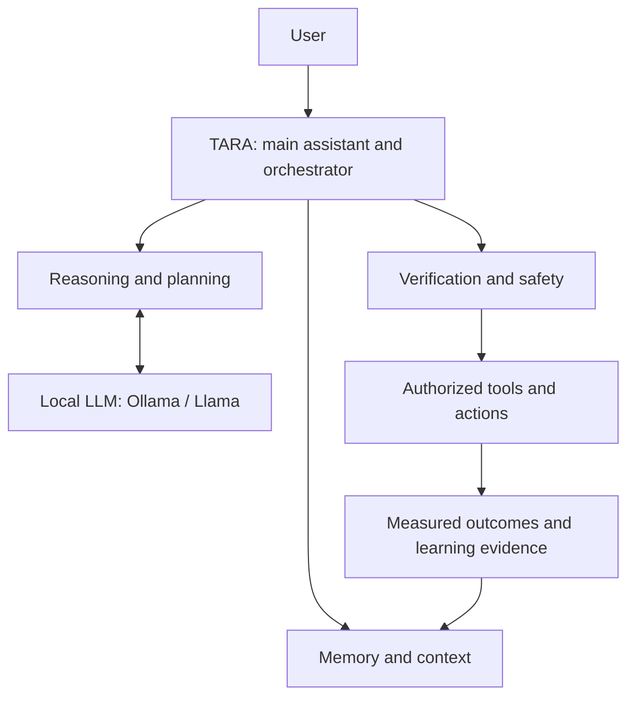

**Core boundary:** TARA owns the cognitive/orchestration layer. Ollama/Llama supplies language generation and reasoning; it does not replace TARA. Current local model is `llama3.2:3b`, selected with `TARA_LLM_BACKEND=ollama`.

### 2. Previous work → current state → next step

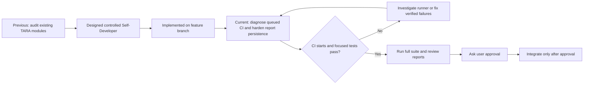

### 3. Current pull-request map

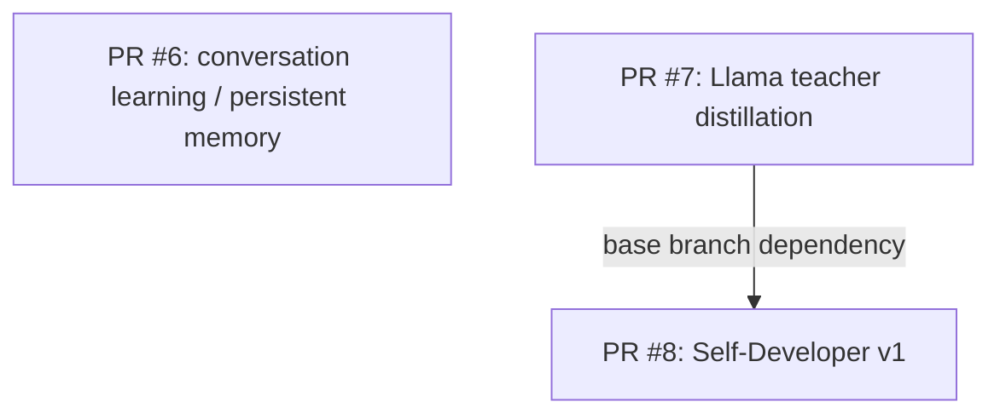

- **PR #6 — conversation learning/memory:** [PR #6 / branch](https://github.com/deathkernel/TARA/tree/feature/tara-conversation-learning). Adds user-approved persistent memory commands. Draft/open and not merged as last reported.
- **PR #7 — teacher distillation:** [PR #7 / branch](https://github.com/deathkernel/TARA/tree/feature/tara-llama-distillation). Generates candidate multi-domain teacher examples with local Ollama. Examples need review; this does **not** train a TARA checkpoint. Draft/open and not merged as last reported.
- **PR #8 — Self-Developer v1:** [review PR #8](https://github.com/deathkernel/TARA/pull/8) · [branch](https://github.com/deathkernel/TARA/tree/feature/tara-self-developer-v1). Based on PR #7's branch; draft/open and not merged as last reported.
  - Self-Developer implementation commit: `198c2050c5b689c976b4edeec35a00a028347f07`.
  - README handoff commits: `ceba5cb002f2af8db8a390b11e5d59e9dd125daa`, `461686de55bfc078181d57b39f6b175b68384043`.
  - Adds `src/self_developer.py`, `src/self_developer_cli.py`, tests, and `docs/tara_self_developer.md`.
  - CLI commands: `status`, `plan`, `run`, `report`.
  - Candidate worktree changes are not committed, pushed, merged, or integrated automatically.

### 4. Self-Developer task lifecycle

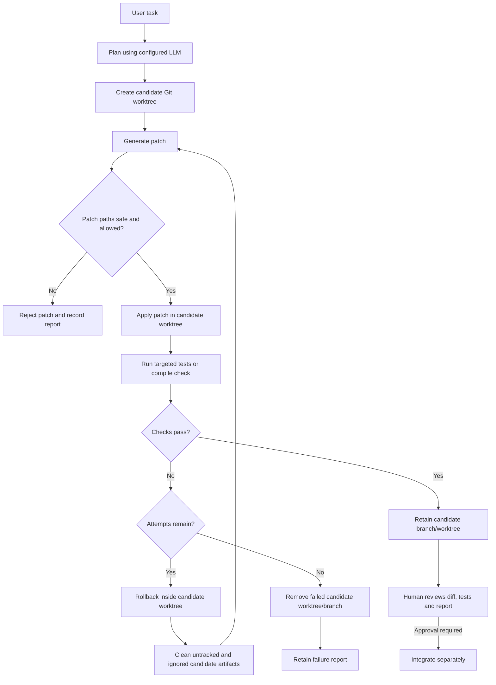

**Safety rules**
- Controlled autonomy: code generation and tests may run in a candidate worktree; approval is required before integration.
- A Git worktree is **not** a hostile-code security sandbox. Review generated code and test behavior.
- Self-Developer protects `checkpoints/`, `outputs/`, `data/conversation_v1.jsonl`, `data/conversation_v1.jsonl.manifest.json`, and `test_voice.py`.
- Never run `git clean`, destructive resets, or cleanup against the original user working tree. Preserve local untracked files and data.

### 5. Validation status — do not guess

**Latest verified PR #8 CI snapshot (2026-10-14):** [run #38598370679](https://github.com/deathkernel/TARA/actions/runs/38598370679), head commit `42691d05dd1a8aeb889d936225abdb5c174a7396), completed successfully. Evidence from the run:
- Static repository audit: passed.
- Focused regression tests: **121 passed** in 6.79 seconds.
- Full Python suite: **499 passed** in 5,349.12 seconds (about 89 minutes).
- XOR smoke experiment: passed.
- Tiny language-model smoke experiment: passed.
- Rust `cargo test --all-targets`: passed.

This is a GitHub-hosted Ubuntu CI result for the recorded head commit; it is **not** a Windows-local test result. A README-only follow-up commit still needs its own CI result before claiming that newer commit is validated. Do not imply that the full suite ran locally.

**CI queue mitigation applied in commit `8364a9b`:**
- `.github/workflows/tests.yml` now uses pull-request and manual-dispatch triggers instead of running duplicate push + pull-request events for every feature-branch commit.
- Workflow concurrency is keyed by PR number (or ref for manual runs) with `cancel-in-progress: true`, so superseded CI runs for the same PR can be cancelled.
- `.github/workflows/experiments.yml` now triggers the expensive three-seed Tiny-vs-Scaled experiment only when its experiment scripts or relevant model/data/training files change, rather than on every `src/**` edit.
- `.github/workflows/tests.yml` runs a focused regression subset before the full suite, so failures in recently changed paths surface early and can avoid another long full-suite run.
- Older experiment jobs already queued under the previous broad path filter may still finish; narrowing future triggers does not cancel historical jobs.

**Implemented on this branch (tests still require execution):**
- Patch validation rejects unsafe/traversal/absolute/protected paths, dependency and workflow edits, nested `.git` metadata, mismatched diff headers/markers, rename/copy/binary metadata, unsafe file modes, and Windows-invalid names (reserved device names, ADS colons, invalid characters/control characters, trailing dots/spaces); ordinary new-file mode `100644` patches remain allowed.
- Isolation: planning context is built from committed `HEAD`; run-task context comes from the candidate worktree, not dirty user checkout files. Candidate context resolves each file and skips paths resolving outside the worktree, preventing tracked symlinks or symlinked parents from exposing external file contents to the configured provider (`2fe38ce`, regression test `fc10f46`). During validation, intent-to-add is restricted to new file paths declared by the already-validated patch, so ignored candidate-generated tests remain discoverable without sweeping unrelated ignored files into the diff. A focused regression simulates an unrelated ignored artifact under `outputs/` and asserts it is excluded from changed-file reporting and the candidate diff. Failed attempts clean untracked/ignored generated artifacts using `git clean -fdx` **only inside the disposable candidate worktree**. If either candidate reset or cleanup fails, retries stop and the failure is reported rather than continuing in a contaminated worktree (`4974b70`, regression test `b7d00eb`). These are code/test changes, not passing-test claims.
- Validation selection: always compiles `src`; source changes run full `pytest -q`; test-only changes run changed test files; docs-only changes compile source.
- Lifecycle/reporting: bounded retries/timeouts, candidate-only rollback/cleanup, retained failure reports, cleanup warnings, and successful candidate retention for human review.
- Teacher dataset audit: read-only JSONL schema/provenance/fingerprint/duplicate/UTF-8 checks, with `ready_for_training: false` regardless of structural success.
- Regression tests were added for the behaviors above. **Code and test additions are not passing-test claims.**

**Current gates after the successful PR #8 run:**
- PR #8: inspect the final diff and perform the focused + full validation on the real Windows checkout; preserve the user's existing branch, untracked data, checkpoints, outputs, conversation files, and `test_voice.py`.
- PR #9 (head `26078f1`): its older CI run [#38585922048](https://github.com/deathkernel/TARA/actions/runs/38585922048) failed in Python (22 failed, 468 passed); Rust passed. This run predates the latest PR #8 head and must be refreshed after the stacked branch is synchronized.
- PR #10 (head `6064bc3`): its older CI run [#38586960158](https://github.com/deathkernel/TARA/actions/runs/38586960158) failed in Python (22 failed, 461 passed); Rust passed. This run also predates the latest PR #8 head and must be refreshed after the branch stack is synchronized.
- Keep PRs draft/open and unmerged. No checkpoint promotion, training run, or NVIDIA/CUDA setup is authorized by this validation result.

### Teacher dataset audit — read-only

Generate candidate examples as before, then audit the file without calling Ollama or changing the dataset:

```bat
python -m src.teacher_distillation --audit data/llama_teacher_v1.jsonl
```

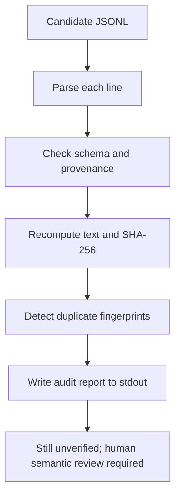

Exit code is `0` when every record passes structural/provenance checks, `1` when records are invalid, and missing files raise a clear error. Even a clean audit **never certifies training readiness**; it cannot determine whether a teacher answer is factually correct, safe, or pedagogically useful.

### 6. Next actions — follow in order

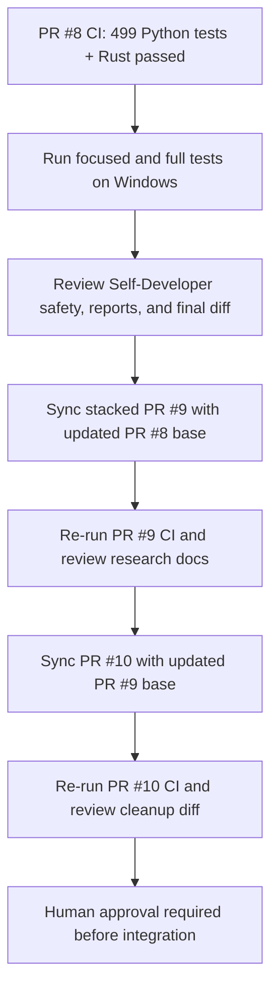

**Windows CMD — preserve local data**

```bat
git status --short
git fetch origin
git switch feature/tara-self-developer-v1
git pull --ff-only
```

If the branch does not exist locally, use `git switch --track origin/feature/tara-self-developer-v1`. Check `git status --short` first. Do not clean/reset the original checkout; preserve `checkpoints/`, `outputs/`, conversation JSONL/manifest files, and `test_voice.py`.

Run focused tests and CLI smoke checks:

```bat
python -m pytest -q tests/test_self_developer.py tests/test_self_developer_cli.py tests/test_teacher_distillation.py
python -m src.self_developer_cli status
python -m src.repository_audit .
```

Then run the full suite:

```bat
python -m pytest -q
```

Use the exact output as evidence in this handoff. Do not claim success from a command that was not executed.

### 7. Keep these distinctions clear

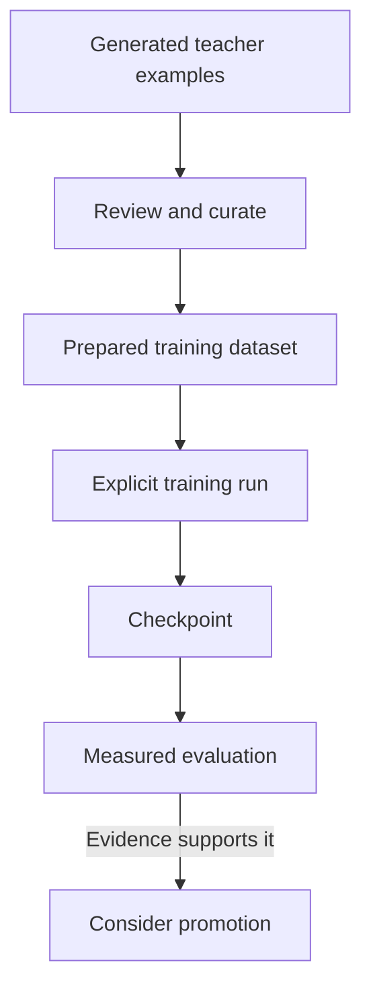

- Persistent conversation memory **is not** model-weight training.
- Teacher-generated examples are not automatically correct and are not TARA's raw pretraining corpus.
- A script or provider integration in source code is not proof that training ran, an API authenticated, or a capability was achieved.
- Report only results supported by actual test/CI output or measured evaluation.
- Previous commands for `src.self_developer_cli` failed before the module existed. The module is now on the PR #8 branch; switch to that branch before using the commands above.

### Additional audit — Self-Developer validation coverage (2026-10-14)

- **Finding:** changed Python files outside `src/` and `tests/` (for example root-level training/data CLIs) were not explicitly compiled by the candidate validator.
- **Fix:** append a fixed `python -m py_compile <changed-file>` command for each changed Python file outside those two directories. Existing source changes still trigger the full test suite; test-only changes still run the changed test files.
- **Regression coverage:** added tests for root-level script-only changes and mixed test/script changes.
- **Validation status:** committed for CI verification; not locally executed in this environment.

### Additional audit — teacher dataset atomic-write safety (2026-10-14)

- **Finding:** the generator used a predictable sibling path named `<output>.tmp`. If that path already belonged to the user, generation could truncate it and a failed provider call could delete it.
- **Fix:** use a uniquely created temporary file in the destination directory, then atomically replace the destination only after successful generation. Failure cleanup removes only the temporary file created by that invocation.
- **Regression coverage:** added tests for successful generation and provider failure with a pre-existing `<output>.tmp` neighbor.
- **Validation status:** code and tests are committed for CI verification; no passing-test claim until CI completes.
- **Next:** inspect the fresh CI run, continue queue diagnosis, then audit persistent memory and teacher-data workflow.

### Additional audit — Self-Developer report persistence (2026-10-14)

- **Finding:** Self-Developer wrote every JSON report through a predictable `.json.tmp` sibling. A pre-existing file with that name could be truncated, and a failed serialization/write could leave an incomplete staging file behind.
- **Fix:** create a unique temporary file in the report directory, serialize fully there, atomically replace the final report only after success, and clean up only the unique temporary file owned by the current write.
- **Regression coverage:** added tests that preserve a pre-existing `report-safety.json.tmp` neighbor on success and preserve both a known-good existing report and the neighbor when JSON serialization fails.
- **Commits:** source hardening `8526069a8f86019ba16632a1d849ec988e78a750`; regression tests `807d09257a5b184224b53f6b72024d168cae447d`.
- **Validation status:** committed for CI; not locally executed in this authoring environment. The latest PR #8 run is queued; do not infer that these new tests passed.
- **Write lifecycle:**

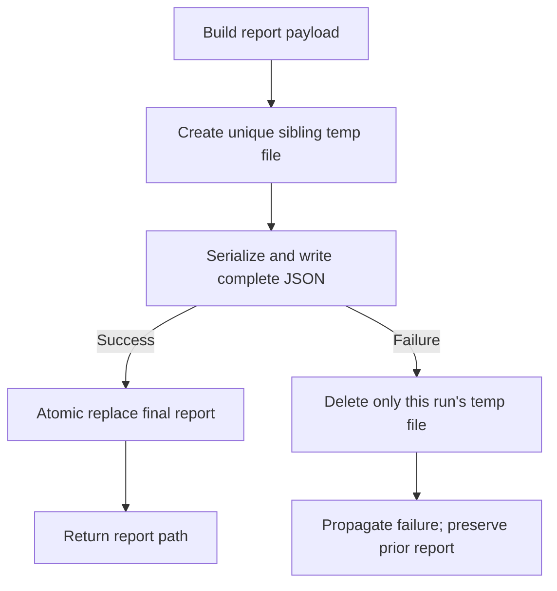

### 8. Update protocol for every meaningful task

After a meaningful change, update this section with:
1. **What changed** — files/features and a short explanation.
2. **Where** — branch, commit and PR link.
3. **Evidence** — exact tests/CI run and pass/fail/pending result.
4. **Still pending** — blockers and decisions awaiting user approval.
5. **Next step** — the next command or review action.
6. **Diagrams** — adjust these when architecture, PR dependencies or task flow changes.

Do not mark work as tested or merged until there is evidence. Keep the diagrams useful and simple; add one when it explains a flow better than a paragraph.

---

## Pre-training readiness — complete

The repository now has an explicit readiness gate before the first real training run:

- **PyTorch dependency declared** in `requirements.txt`.
- **Dataset loader + audit** validate the source corpus before training.
- **Context-fit check** verifies that the corpus can produce training sequences for the requested context length.
- **Training configuration validation** checks model and optimization parameters.
- **CPU/CUDA detection** confirms that the selected training backend is available.
- **No training side effects** — the readiness command only checks prerequisites and never creates a checkpoint.

Run the gate first:

```bash
python training_preflight.py --data data/algorithm_tasks.jsonl --context 128
```

A successful preflight means the repository prerequisites are satisfied. It does **not** mean that training has already happened or that the resulting model will be capable; those require an actual training run and measured evaluation.

## Public curriculum dataset pipeline

TARA now has a bounded public-dataset acquisition layer. It streams selected Hugging Face datasets instead of downloading entire multi-terabyte corpora, then applies text-length filtering, deterministic shuffling, cross-source deduplication, provenance/license metadata and a reproducible fingerprint.

The current curriculum manifest is in `data/dataset_sources.json`.

### Basic level

- **FineWeb-Edu** — educational web text for general language and knowledge learning.
- **GSM8K** — mathematical word-problem reasoning.
- **TinyStories** — optional small-language-model warm-up corpus.

### Advanced level

- **FineWeb** — broad English web pretraining data.
- **The Stack v2 Smol** — advanced code data; source licenses and upstream terms must be respected.

Prepare a bounded Basic v1 sample without downloading an entire corpus:

```bash
python prepare_tara_dataset.py --level basic --max-records-per-source 1000 --output data/basic_v1.jsonl
```

The resulting JSONL is directly consumable by the existing training pipeline because each curated record contains a `text` field. The preparation command is an explicit data operation; it does not start model training.

The public source manifest records dataset identity, organization, role and stated licensing information. Downstream use must still follow each upstream dataset's current terms and provenance requirements.

## Phase 37.11 — Single-Command Learning Pipeline Complete

`run_learning_experiment.py` connects baseline evaluation, explicit training, candidate evaluation and evidence-gated promotion into one reproducible workflow.

```bash
python run_learning_experiment.py checkpoints/baseline.pt data/algorithm_tasks.jsonl checkpoints/candidate.pt --steps 100
```

The candidate is accepted only after real evaluation shows strict overall improvement without a permitted category regression. Training is an injected explicit operation; no normal TARA runtime silently starts heavy training.

## Phase 37.10 — Learning Experiment Pipeline Complete

Phase 37.10 adds `src/learning_experiment.py` for baseline/candidate evaluation, capability deltas, checkpoint existence checks, regression protection and experiment fingerprints.

## Phase 37.8 — Real Model Capability Evaluation Complete

Phase 37.8 connects the capability suite to an actual TARA checkpoint instead of only synthetic solvers:

- **Real checkpoint loader** — evaluates checkpoints through the existing model runtime.
- **Deterministic greedy inference** — capability measurements use reproducible decoding rather than sampling noise.
- **21-case capability suite** — coding, reasoning, memory, planning, tool use, algorithms and learning are evaluated separately.
- **Model/evaluation fingerprints** — architecture/tokenizer configuration and benchmark results are traceable.
- **Dedicated CLI** — `evaluate_tara_capabilities.py <checkpoint>` runs the evaluation without training.
- **Core integration** — `TARACore.evaluate_checkpoint(...)` exposes real-model evaluation through the top-level runtime.
- **No promotion side effects** — evaluation is inference-only and cannot silently modify or promote a checkpoint.

Example:

```bash
python evaluate_tara_capabilities.py checkpoints/algorithm_lm.pt --output experiments/tara-capability-baseline.json
```

A missing checkpoint is an execution prerequisite, not a reason to invent a score. The repository therefore reports real capability scores only after an actual checkpoint exists and the evaluation command has run.

## Phase 37.7 — Evidence-Gated Intelligence Improvement Complete

Phase 37.7 closes the measurement-to-improvement loop without pretending that a benchmark failure automatically means a specific training method will fix it:

- **Failure analysis** — failed and partial benchmark cases become explicit capability failures with severity.
- **Targeted planning** — failures are grouped into capability targets with deterministic priority and training hints.
- **Bounded experiment boundary** — an injected candidate runner performs the actual training/evaluation work; the improvement engine itself never silently trains.
- **Regression protection** — candidate results are checked against overall and category-level regression limits.
- **Promotion gate** — a candidate is accepted only when it produces a strict overall improvement and passes the regression gate.
- **Deterministic provenance** — proposal and improvement reports receive SHA-256 fingerprints.
- **Brain integration** — `TARABrain` exposes `benchmark_intelligence`, `propose_intelligence_improvement`, and `improve_intelligence`.

This is an evidence-gated optimization loop, not proof of autonomous intelligence. Actual model improvement still requires an executed training experiment and a benchmark run against the resulting checkpoint.

## Phase 37.6 — Capability Benchmark Suite Complete

Phase 37.6 expands measurement from a four-case smoke test into a multi-capability deterministic suite:

- **Coding** — arithmetic, string transformation and ordering.
- **Reasoning** — transitive reasoning, negation and arithmetic.
- **Memory** — explicit fact/token/sequence recall.
- **Planning** — ordering, dependencies and plan validation.
- **Tool use** — capability selection, verification and emergency-stop behavior.
- **Algorithms** — correctness gates, performance comparison and regression rejection.
- **Learning** — replay/forgetting, evidence gating and improvement validation.
- **Regression-safe scoring** — the existing benchmark engine keeps category-level and overall regression gates explicit.

The suite evaluates an injected solver; it does not execute arbitrary model output or grant permissions. A perfect synthetic solver test demonstrates benchmark mechanics, not that TARA itself has achieved those capabilities.

## Phase 37.5 — Auditable Training Experiments Complete

Phase 37.5 turns training into an explicit, reproducible experiment boundary:

- **Dataset preflight** — training is blocked when the dataset audit reports error-level split overlap.
- **Stable experiment identity** — dataset fingerprint + complete training configuration produce a deterministic experiment ID.
- **Training handoff** — the runner delegates to the hardened PyTorch pipeline with accumulation, scheduler, early stopping and checkpoints.
- **Manifest output** — dataset/audit fingerprints, checkpoint, metrics, steps, losses, device and configuration are persisted as JSON.
- **Dedicated CLI** — `run_training_experiment.py` exposes the complete experiment workflow without silently training during runtime.
- **Model controls** — the existing trainer exposes depth, dropout, weight tying and all Phase 37.3 optimization controls.

Actual model training remains an explicit offline operation. Repository code does not claim a trained model until a training command has actually executed and produced a checkpoint.

## Phase 37.4 — Neural Core Upgrade Complete

Phase 37.4 upgrades the accelerated Transformer language core with configurable depth, RMSNorm, dropout, and optional embedding/output weight tying while preserving explicit architecture boundaries and checkpoint metadata.

## Phase 37.3 — Training Hardening Complete

Phase 37.3 connects the training-control layer to the real PyTorch pipeline:

- **Gradient accumulation** — optimizer updates can aggregate multiple micro-batches while keeping the configured batch size bounded.
- **Warmup + cosine decay** — learning rate is scheduled per optimizer update with a configurable minimum ratio.
- **Validation early stopping** — validation loss drives explicit patience/min-delta stopping decisions.
- **Append-only experiment tracking** — training metrics are persisted as JSONL with a stable SHA-256 fingerprint.
- **Checkpoint continuity** — checkpoint format 3 stores hardening configuration, scheduler progress, early-stopping state and metric fingerprint plus the Phase 37.4 model configuration.
- **Resume safety** — incompatible dataset fingerprints, model configuration or training controls are rejected rather than silently mixing experiments.
- **CLI controls** — `train_algorithm_lm.py` exposes accumulation, scheduler, early-stopping, model-depth, dropout and metrics-path options.

## Phase 37.2 — Dataset Intelligence Audit Complete

Phase 37.2 adds a deterministic audit boundary before training:

- **Dataset quality** — detects empty and unusually short examples.
- **Duplicate analysis** — fingerprints normalized examples and reports duplicate records.
- **Split leakage detection** — compares train/validation/test fingerprints and raises an error-level issue for overlap.
- **Evaluation contamination signals** — configurable markers such as ground-truth/test-answer language are surfaced for review.
- **Reproducibility** — dataset audit reports receive stable SHA-256 fingerprints.
- **Non-destructive operation** — auditing never modifies the source corpus.
- **JSONL support** — prepared corpora can be audited directly from JSONL files.

The audit is a signal, not a proof of dataset quality: semantic contamination and memorization require deeper analysis than string fingerprints alone.

## Phase 37.1 — Intelligence Baseline Benchmark Started

Phase 37 begins with measurement before model changes. This avoids treating architecture size or training loss as a proxy for intelligence.

- **Benchmark case model** — each task has an ID, capability category, expected result, optional custom scorer and weight.
- **Deterministic scoring** — exact and normalized-text scorers are provided, with strict `[0, 1]` validation for custom metrics.
- **Category aggregation** — weighted overall and per-capability scores are reported.
- **Failure capture** — solver exceptions become measured failed cases rather than crashing the entire benchmark.
- **Stable fingerprints** — benchmark inputs and measured results receive SHA-256 fingerprints for experiment traceability.
- **Regression gate** — candidate reports are compared against a baseline with explicit overall and category-drop tolerances.


---

# TARA — Complete Engineering Phase Report

> **Status note:** This report describes capabilities and engineering milestones that are represented by the current repository history and source tree. A phase being marked complete means the corresponding software/tests/documentation were implemented; it does **not** by itself prove that TARA has achieved human-level intelligence, autonomous general intelligence, or a production-ready trained model.

## 1. Architecture foundation

The earliest TARA work established the project as a modular artificial-reasoning architecture rather than a single opaque model. The foundation separates language generation from cognitive subsystems such as memory, perception, planning, tools, verification and learning. The repository continues to preserve that separation through explicit Python modules and testable interfaces.

## Phase-by-Phase Coverage Index

The report below intentionally covers **every numbered phase from Phase 1 through Phase 37**. Where the current repository history contains a dedicated implementation/documentation trail, the concrete work is described. Where no standalone phase specification is preserved, the entry explicitly says so rather than inventing undocumented features.

| Phase | Repository-supported focus | Documentation status |
|---|---|---|
| 1 | Project/neural architecture foundation | Historical details not preserved as a standalone phase document |
| 2 | Early model/data foundation and transition work | Historical details not preserved as a standalone phase document |
| 3 | Memory primitives | Documented |
| 4 | Early architecture/data transition | Standalone specification not preserved |
| 5 | Perception primitives | Implemented + tested |
| 6 | Cognitive integration layer | Implemented + tested |
| 7 | Agent loop | Implemented + tested |
| 8 | Safety foundation | Implemented + tested |
| 9 | AI architecture consolidation | Standalone specification not preserved |
| 10 | AI architecture consolidation | Standalone specification not preserved |
| 11 | AI architecture consolidation | Standalone specification not preserved |
| 12 | AI architecture consolidation | Standalone specification not preserved |
| 13 | Training/data transition | Standalone specification not preserved |
| 14 | Training ↔ Brain integration | Implemented + documented |
| 15 | Continual learning + memory consolidation | Implemented + documented |
| 16 | Controlled file/tool stack | Implemented + tested |
| 17 | Reflection + experience | Implemented + tested |
| 18 | Autonomous task orchestration | Implemented + tested |
| 19 | Resources + persistent scheduling | Implemented + tested |
| 20 | World model + event context | Implemented + tested |
| 21 | Confidence-aware perception + temporal awareness | Implemented + documented |
| 22 | Structured reasoning | Implemented + tested |
| 23 | Reasoning-system transition | Standalone specification not preserved |
| 24 | Tool intelligence | Implemented + tested |
| 25 | Integration transition | Standalone specification not preserved |
| 26 | Verified self-improvement | Implemented + tested |
| 27 | Advanced/persistent continual learning | Implemented + documented |
| 28 | Persistent cognitive memory | Documented |
| 29 | Cognitive-system transition | Standalone specification not preserved |
| 30 | Multimodal perception | Implemented + integrated |
| 31 | Autonomous research | Implemented + tested |
| 32 | Scientific experiments | Implemented + tested |
| 33 | Architecture self-optimization | Implemented + tested |
| 34 | Unified cognitive loop | Implemented + tested |
| 35 | TARA Core runtime | Implemented + tested |
| 36 | Repository audit + canonical CI | Implemented + tested |
| 37 | Intelligence measurement, training and evidence-gated learning | Implemented through 37.12 |

## Phase 1 — Foundation

Phase 1 is part of TARA's earliest architecture history. The current repository does not preserve a standalone Phase 1 specification detailed enough to safely reconstruct every original requirement. The phase is therefore recorded as the project/neural architecture foundation without inventing historical implementation claims.

## Phase 2 — Early model/data foundation

Phase 2 belongs to the early model/data foundation and transition into the explicit cognitive architecture. A dedicated Phase 2 specification is not currently preserved in the repository, so its historical details are intentionally not fabricated.

## Phase 3 — Memory primitives

Phase 3 established explicit memory primitives: structured state that can be stored, retrieved and consumed by later cognitive layers.

## Phase 4 — Early architecture/data transition

No standalone Phase 4 specification is currently preserved. Later perception, cognition and training layers build on the early model/data/memory foundations.

## Phase 5 — Perception primitives

Phase 5 added perception primitives and tests, making observations an explicit subsystem in the architecture.

## Phase 6 — Cognitive integration

Phase 6 connected early perception, memory and reasoning components into a cognitive integration layer and added integration tests.

## Phase 7 — Agent loop

Phase 7 introduced the agent loop for iterative task processing, decision-making and bounded execution.

## Phase 8 — Safety foundation

Phase 8 established safety boundaries around agent behavior, including explicit permissions and bounded operations.

## Phase 9 — AI architecture consolidation

The repository history does not preserve a standalone Phase 9 specification. It is included here as an explicit historical phase entry without unsupported feature claims.

## Phase 10 — AI architecture consolidation

No standalone Phase 10 specification is currently preserved. The phase is retained in the complete chronology rather than silently omitted.

## Phase 11 — AI architecture consolidation

No standalone Phase 11 specification is currently preserved. Later milestones build on the consolidated AI architecture.

## Phase 12 — AI architecture consolidation

No standalone Phase 12 specification is currently preserved. The project history transitions toward the explicit training pipeline that became Phase 14.

## Phase 13 — Training/data transition

No standalone Phase 13 specification is currently preserved. It is treated as the transition into the reproducible learned-language training path of Phase 14.

# 2. Core neural/data foundations

The early development stages established the mathematical and software primitives required by later cognitive layers: model components, datasets/tokenization, training utilities, losses/optimization and deterministic testing. These foundations support both small experimental models and the later accelerated language-model pipeline.

**Historical documentation note:** the current repository does not preserve a standalone phase brief for every early numbered milestone (especially 1, 2 and 4, and some transition phases before Phase 14). This report therefore does not invent undocumented feature lists for those milestones.

## 3. Memory primitives

Phase 3 introduced explicit memory primitives. The design treats memory as structured state that can be stored, retrieved and used by higher-level reasoning rather than assuming that neural weights alone are the complete memory system.

## 4. Transition/foundation milestone

No standalone Phase 4 specification is currently preserved in the repository history. Later perception, cognition and training layers build on the early model/data/memory foundations.

## 5. Perception primitives

Phase 5 added perception primitives and corresponding tests. Perception became an explicit subsystem so observations can be represented and passed into the cognitive stack instead of being mixed directly into model internals.

## 6. Cognitive integration layer

Phase 6 connected the early subsystems into a cognitive integration layer and added integration tests. The goal was to make memory, perception and reasoning components composable inside a single architecture.

## 7. Agent loop

Phase 7 introduced the agent loop: iterative processing of a task through cognitive state, decision logic and bounded execution. Tests cover the loop behavior separately from individual components.

## 8. Safety foundation

Phase 8 established safety boundaries around agent behavior. The architecture emphasizes explicit permissions, bounded operations and tests around safety conditions rather than granting unrestricted authority to generated output.

## 9–13. AI-system consolidation and transition to learned training

The repository history shows an extended consolidation period between the early cognitive architecture and the explicit training pipeline. During this period the project separated deferred PC-specific tools from the core AI architecture and prepared the dataset/model interfaces used by Phase 14.

Because the current tree does not retain standalone specifications for each of Phases 9–13, they are documented here as a transition block rather than assigning unsupported feature claims to individual numbers.

## 14. Training ↔ Brain integration

Phase 14 established the reproducible learned-language training path:

- deterministic train/validation splitting;
- character/token sequence preparation;
- checkpoint save/load and resume;
- validation loss measurement;
- integration of the trained language core with TARA's brain/runtime;
- an algorithm-language-model CLI and training tests.

The training pipeline is explicit: normal runtime code does not silently start expensive training.

## 15. Continual learning and memory consolidation

Phase 15 introduced controlled continual-learning primitives:

- bounded replay of verified knowledge;
- memory consolidation using deterministic access/importance signals;
- evidence-gated learning;
- explicit separation between knowledge preparation and actual training.

The system is designed so verified information can become training material without allowing generated code or unverified output to silently retrain the model.

## 16. Controlled tool stack

Phase 16 added an allow-listed file/tool layer. Tools are exposed through explicit interfaces with safety boundaries and tests. The architecture distinguishes between a model suggesting an action and TARA actually being permitted to execute it.

## 17. Reflection and experience

Phase 17 added:

- experience/outcome records;
- success/failure signals;
- reflection notes;
- goal-progress tracking;
- a reflection loop;
- brain integration and tests.

This is deterministic experience tracking, not a claim of human-like self-awareness.

## 18. Autonomous task orchestration

Phase 18 introduced explicit task orchestration with:

- task dependencies;
- priorities;
- bounded retries;
- verification feedback;
- stop/resume controls;
- integration into the brain.

External work remains bounded by supplied callables or already-authorized tools.

## 19. Resources and persistent scheduling

Phase 19 added resource-aware task scheduling and persistence. TARA can represent scheduled work, priorities and resource constraints without turning scheduling into unrestricted autonomous execution.

## 20. World model and event context

Phase 20 added a world-state/event-context layer and event routing. Tasks can react to explicit world-state changes and triggers, while the brain receives structured contextual information.

## 21. Confidence-aware perception and temporal awareness

Phase 21 added confidence-aware temporal perception. The system can represent temporal context and confidence rather than treating every observation as equally certain.

## 22. Structured reasoning

Phase 22 added a structured reasoning engine with explicit state and verification. The reasoning layer is connected to the brain so intermediate reasoning state can be inspected and validated instead of being treated as an opaque text response.

## 23. Reasoning-system transition

The current repository history does not retain a standalone Phase 23 specification. It sits between structured reasoning and the documented Phase 24 tool-intelligence milestone, so this report does not assign unsupported features to it.

## 24. Tool intelligence

Phase 24 added AI-driven tool selection and recovery:

- tool capability selection;
- verification-aware execution;
- recovery behavior;
- integration into the brain;
- tests for selection and recovery.

The important architectural boundary is that tool intelligence can select among **already available/authorized** tools; it does not manufacture permissions.

## 25. Integration transition

No standalone Phase 25 specification is currently preserved in the repository. Later self-improvement work builds on the reasoning/tool stack.

## 26. Self-improvement

Phase 26 added a verified self-improvement system:

- benchmark-driven improvement proposals;
- iterative improvement experiments;
- persistent benchmark evidence;
- promotion checks;
- an advanced self-improvement lab;
- brain integration.

The promotion loop is evidence-gated: an attempted improvement is not automatically accepted merely because it was generated.

## 27. Continual-learning engine

Phase 27 expanded continual learning beyond the Phase 15 primitives. The repository added a persistent continual-learning cycle that can export verified knowledge and failed attempts into deterministic replay/targeted examples, construct training material and connect to the existing training pipeline.

## 28. Persistent cognitive memory

Phase 28 documented persistent cognitive memory as a durable layer for retaining useful experiences/knowledge across runtime sessions. This complements the learned model rather than treating model weights as the only persistent state.

## 29. Cognitive-system transition

No standalone Phase 29 specification is currently preserved. The next documented milestone is the multimodal perception core in Phase 30.

## 30. Multimodal perception core

Phase 30 introduced a multimodal perception core and integrated it into the brain. The architecture was extended so perception is not restricted to a single text-only representation.

## 31. Autonomous research engine

Phase 31 implemented an autonomous research engine with tests and brain integration. Research is treated as an explicit workflow with bounded operations rather than unrestricted browsing or action.

## 32. Scientific experiment engine

Phase 32 introduced a scientific experiment engine with:

- explicit experiment definitions;
- reproducibility controls;
- tests;
- process-stable reproducibility;
- brain integration.

The purpose is to make experiments repeatable and auditable rather than merely generating plausible-looking conclusions.

## 33. Architecture self-optimization

Phase 33 added architecture self-optimization with tests and brain integration. Candidate architectural changes remain explicit experiments rather than automatically replacing the running system.

## 34. Unified cognitive loop

Phase 34 connected the major cognitive subsystems into a unified loop. The loop brings together perception/context, memory, reasoning, planning, tools, verification, reflection and learning-related signals under explicit orchestration.

## 35. TARA Core runtime

Phase 35 consolidated the architecture behind a top-level `TARACore` runtime. It owns:

- lifecycle management;
- component discovery;
- health diagnostics;
- event tracing;
- safe shutdown;
- neural/runtime APIs.

Domain logic remains in specialized modules, keeping the core runtime as an orchestrator rather than a monolithic implementation.

## 36. Repository audit and validation

Phase 36 added a static repository auditor and canonical CI validation. The audit checks repository structure, Python syntax and required project components. The CI consolidation provides one canonical validation path instead of fragmented checks.

## 37. Intelligence measurement and evidence-gated learning

Phase 37 is a measurement-first intelligence program and is now subdivided into concrete engineering milestones.

### Phase 37.1 — Intelligence baseline benchmark
Introduced deterministic capability measurement before changing the model:

- benchmark case IDs and categories;
- expected results and custom scorers;
- weighted category/overall aggregation;
- failure capture;
- stable SHA-256 fingerprints;
- regression gates.

### Phase 37.2 — Dataset intelligence audit
Added dataset quality and contamination auditing:

- empty/short-example detection;
- normalized duplicate fingerprints;
- train/validation/test leakage detection;
- configurable contamination markers;
- reproducible audit fingerprints;
- non-destructive JSONL auditing.

### Phase 37.3 — Training hardening
Connected advanced controls to the real PyTorch pipeline:

- gradient accumulation;
- warmup + cosine learning-rate decay;
- validation-based early stopping;
- append-only JSONL experiment metrics;
- checkpoint continuity;
- resume compatibility checks;
- CLI controls for training behavior.

### Phase 37.4 — Neural core upgrade
Upgraded the Transformer language core with configurable:

- model depth;
- RMSNorm;
- dropout;
- optional embedding/output weight tying;
- checkpoint architecture metadata.

### Phase 37.5 — Auditable training experiments
Made training an explicit experiment boundary:

- dataset preflight;
- deterministic experiment identity;
- explicit training handoff;
- checkpoint output;
- metrics;
- JSON experiment manifests;
- reproducible provenance.

### Phase 37.6 — Capability benchmark suite
Expanded measurement into separate capability categories:

- coding;
- reasoning;
- memory;
- planning;
- tool use;
- algorithms;
- learning.

The suite uses injected solvers and does not execute arbitrary model output.

### Phase 37.7 — Evidence-gated intelligence improvement
Connected measurement failures to bounded improvement proposals:

- failure analysis;
- capability targeting;
- experiment boundaries;
- regression protection;
- promotion gates;
- deterministic proposal/report fingerprints;
- brain-level improvement APIs.

### Phase 37.8 — Real-model capability evaluation
Moved capability evaluation from synthetic solvers to actual checkpoints:

- real checkpoint loading;
- deterministic greedy inference;
- 21-case capability suite;
- model/evaluation fingerprints;
- dedicated evaluation CLI;
- `TARACore.evaluate_checkpoint()`;
- inference-only evaluation with no promotion side effects.

### Phase 37.9 — Evaluation/training continuity
The current Phase 37 stack preserves a continuous evidence chain between dataset preparation, training, checkpoint generation and capability measurement. Generated-code execution is deliberately fail-closed in the repository: capability scores that require code execution must use an injected isolated execution backend. The default host runtime never executes generated programs.

### Phase 37.10 — Learning experiment pipeline
Added `src/learning_experiment.py` for baseline/candidate evaluation, capability deltas, checkpoint checks, regression protection and experiment fingerprints.

### Phase 37.11 — Single-command learning pipeline
Connected baseline evaluation, explicit training, candidate evaluation and evidence-gated promotion:

```bash
python run_learning_experiment.py checkpoints/baseline.pt data/algorithm_tasks.jsonl checkpoints/candidate.pt --steps 100
```

A candidate is accepted only when measured improvement satisfies the configured regression/progression gates.

### Phase 37.12 — Learning consolidation
Added post-training evidence consolidation so an executed learning result can become durable cognitive memory. The consolidation layer does not independently promote checkpoints; promotion remains an explicit evidence-based decision.

---

# Current architecture

At a high level, the current TARA design is:

```text
                         ┌─────────────────────┐
                         │       User/Input    │
                         └──────────┬──────────┘
                                    │
                         perception / context
                                    │
                                    ▼
                    ┌────────────────────────────┐
                    │       TARA Core / Brain    │
                    │                            │
                    │ memory · reasoning         │
                    │ planning · reflection      │
                    │ world model · temporal     │
                    │ task orchestration         │
                    └───────┬─────────┬──────────┘
                            │         │
                    authorized tools  │ language reasoning
                            │         │
                            ▼         ▼
                       Tool layer   Local/Hosted LLM
                            │         │
                            └────┬────┘
                                 │
                           verification
                                 │
                                 ▼
                       learning / consolidation
                                 │
                                 ▼
                         measured evidence
```

## Optional Groq language backend

TARA now includes an optional Groq provider. Groq is an **inference backend**, not the owner of TARA's cognitive architecture.

The intended boundary is:

```text
User
  ↓
TARA perception / memory / planning / context
  ↓
Groq (optional language/reasoning backend)
  ↓
TARA verification / tool execution
  ↓
memory / reflection / learning evidence
```

The provider supports TARA-side daily request/token budgets and reads the API key from `GROQ_API_KEY`. The real API key must remain local and must never be committed to Git.

Example local configuration:

```env
GROQ_API_KEY=gsk_...
TARA_GROQ_MODEL=openai/gpt-oss-20b
TARA_GROQ_MAX_DAILY_REQUESTS=20
TARA_GROQ_MAX_DAILY_TOKENS=50000
TARA_GROQ_MAX_COMPLETION_TOKENS=1024
```

**Important:** an API integration being present in source code does not mean an API call has been successfully authenticated or that a trained TARA checkpoint exists. Those are execution-time facts and should be reported only after testing.

---

# Training and evaluation map

## Preflight

```bash
python training_preflight.py --data data/algorithm_tasks.jsonl --context 128
```

## Fast TinyStories experiment

```bash
python train_fast.py --dataset tinystories --steps 1000 --batch-size 16
```

## Algorithm language-model training

```bash
python train_algorithm_lm.py --data data/algorithm_tasks.jsonl
```

## Capability evaluation

```bash
python evaluate_tara_capabilities.py checkpoints/algorithm_lm.pt --output experiments/tara-capability-baseline.json
```

## Evidence-gated learning experiment

```bash
python run_learning_experiment.py checkpoints/baseline.pt data/algorithm_tasks.jsonl checkpoints/candidate.pt --steps 100
```

---

# Engineering principles

1. **Measurement before claims** — architecture size and training loss are not treated as intelligence scores.
2. **Explicit training** — normal runtime execution does not silently launch heavy training.
3. **Evidence-gated promotion** — a candidate checkpoint must pass measurable evaluation and regression checks before promotion.
4. **Deterministic provenance** — datasets, experiments and benchmark reports receive stable fingerprints where supported.
5. **Bounded tools** — generated text does not automatically receive permissions.
6. **Verification before learning** — unverified model output is not silently promoted into durable knowledge.
7. **Separation of concerns** — TARA owns cognition/orchestration; optional providers such as Groq supply inference.
8. **Reproducibility** — seeds, configuration, dataset identity, checkpoints and metrics are treated as first-class experiment data.
9. **No invented capability claims** — a capability is reported only when the relevant code path and measurement have actually executed.
10. **Inspectable architecture** — major cognitive functions remain represented as explicit modules instead of being hidden behind one opaque call.

# What is implemented vs. what still requires execution

Implemented in the repository:
- modular cognitive architecture;
- memory/perception/reasoning/planning/tool layers;
- reflection and continual-learning primitives;
- training and checkpoint pipeline;
- training hardening;
- benchmark/evaluation infrastructure;
- evidence-gated learning workflows;
- repository audit/CI;
- optional Groq provider.

Still dependent on actual runtime experiments:
- successful authentication to any external LLM provider;
- a newly trained checkpoint;
- benchmark scores for that checkpoint;
- measured improvement over a baseline;
- real-world autonomous performance;
- claims about general intelligence or human-level reasoning.

This distinction is intentional: **source-code capability, executed capability, and measured capability are three different things in TARA.**


## ElevenLabs voice output

TARA can optionally speak generated responses through an ElevenLabs voice. The voice provider is separate from TARA's cognition, so memory, reasoning, planning and verification remain TARA-owned.

Install the dependency:

```bash
pip install elevenlabs
```

Configure the local environment:

```env
ELEVENLABS_API_KEY=your_api_key
ELEVENLABS_VOICE_ID=your_voice_id
ELEVENLABS_MODEL=eleven_v4
ELEVENLABS_OUTPUT_FORMAT=mp3_44100_128
```

Then use the configured voice from the brain/core:

```python
response = brain.respond("Hello", speak=True)
# or
audio = core.speak(response.text)
```

The API key is never stored in the repository. The ElevenLabs voice ID is also configuration-driven, so you can change TARA's voice without changing code.

ElevenLabs' current Python SDK supports `text_to_speech.convert(...)` with a selected `voice_id`, model and output format. See the official API documentation for the current parameters.

---

## Current engineering handoff — 2026-10-14

### Latest CI diagnosis: Self-Developer / model evaluation

The latest reviewed Python CI run reported **7 failures and 112 passes**. The Rust test job passed. The Python full-suite and optional smoke experiments were skipped after the focused regression stage failed. The failure report is evidence for what to investigate, not proof that the current branch is validated.

The first audit isolated these causes:

1. **Model benchmark lookup mismatch.** `ModelCapabilityRunner` stores generated observations by benchmark case ID, but `IntelligenceBenchmark.run()` calls the solver with the case prompt. The previous lookup therefore raised a `KeyError` for a prompt such as `x`. The runner now adapts case-ID observations to prompt-keyed solver lookup, with a regression test.
2. **Empty-suite handling in Self-Developer.** Source changes normally trigger the full pytest suite. In a minimal candidate worktree with no test files, pytest exits with code 5 (“no tests collected”), which incorrectly marked an otherwise valid candidate as failed. Validation now detects whether test files exist before scheduling pytest; Python source compilation still runs. A regression test covers this branch.
3. **Timeout fixture construction.** The timeout test itself used `TimeoutExpired(args=...)`, which is not the Python API; it now constructs `TimeoutExpired(cmd=...)` so the intended timeout handling can actually be tested.

### Validation flow after the fix

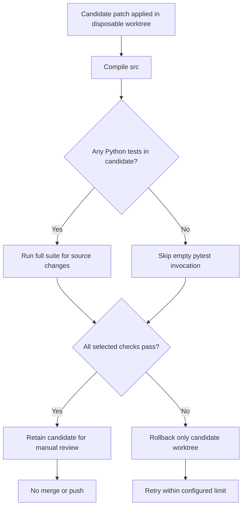

### Current status and next actions

- Fixes for the three findings above are committed to `feature/tara-self-developer-v1`.
- Regression coverage was added for prompt-based benchmark scoring and for source validation when no test suite exists.
- **CI after these commits is the next acceptance gate.** Do not describe the branch as passing until the new GitHub Actions run completes successfully.
- Two cognitive-loop/core end-to-end tests also failed in the previous run. Their underlying cause is not yet established; inspect the new CI output and trace report/step status before changing runtime behavior.
- Keep the Self-Developer timeout, rollback, protected-path and atomic-report tests enabled.
- Preserve `checkpoints/`, `outputs/`, conversation JSONL/manifest files, and `test_voice.py`.
- Keep all PRs unmerged unless the user explicitly approves integration.

### Resume checklist for the next session

1. Check the newest workflow run for PR #8 and inspect all job results.
2. If the Python suite still fails, fetch the complete traceback and the report/trace state for each remaining cognitive-loop/core failure; fix the cause and add a focused regression test.
3. Confirm the benchmark test reports a passing case and the Self-Developer retry tests reach `candidate_ready_for_review`.
4. Wait for the complete Python suite and Rust job; report only the checks that actually ran.
5. Update this handoff section with the new run URL, counts, and remaining blockers before moving to the next PR.

### Follow-up audit — dependency-aware scheduler (2026-10-14)

The earlier end-to-end failures in both `UnifiedCognitiveLoop` and `TARACore` shared a planner bug: `AdaptivePlan.ready_steps()` changed a pending step to `READY`, but later calls only selected `PENDING` steps. After completing the first step, the next scheduler query therefore found no ready step and the run stopped after one cycle. The scheduler now returns dependency-satisfied steps in either `PENDING` or `READY` state; a regression test verifies repeated discovery before execution. This preserves the existing state model and fixes the shared root cause instead of weakening the end-to-end assertions.

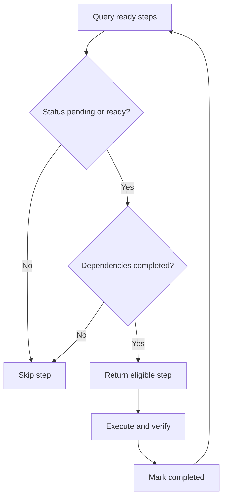

The next CI run must verify the scheduler fix and the previous Self-Developer/model-evaluation changes together. Candidate retry/report failures are not yet considered resolved until their detailed report errors and CI assertions are checked.


### CI follow-up — Git worktree branch marker (2026-10-14)

- Latest run [#1168](https://github.com/deathkernel/TARA/actions/runs/38597619110) completed with the repository static audit passing, **120 focused regression tests passing and 1 failing**, and Rust tests passing. The full Python suite and smoke experiments were skipped because the focused step failed.
- The sole failure was in `test_successful_candidate_is_retained_for_manual_review`: Git prints a `+ ` marker before a branch checked out in a linked worktree. The test compared raw `git branch --list` output to the bare branch name, so it rejected valid Git output; candidate retention itself had succeeded.
- The assertion now normalizes Git's `*` (current branch) and `+` (linked-worktree branch) display markers before comparing the branch name. It still checks that the candidate branch exists and does not weaken candidate isolation assertions.
- Validation status: this is a test correction based on the actual CI traceback. The fix has **not yet been validated by a new CI run**. Wait for focused tests, full Python suite, smoke experiments, and Rust tests to finish before describing PR #8 as passing.

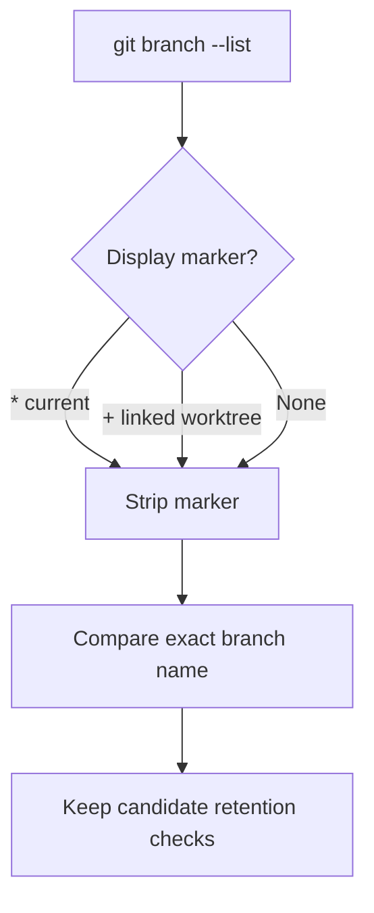

Resume next: inspect the newest CI run; if focused tests pass, verify the full Python suite and smoke experiments. Do not merge any PR without explicit approval.

### CI re-verification — current Self-Developer branch (2026-10-14)

Latest completed CI for the code-bearing branch head before this README-only handoff update: [TARA CI run #38615254519](https://github.com/deathkernel/TARA/actions/runs/38615254519), on commit `19fc99df7d73584d98be9b549a15ce95fb08a94b`. Both jobs completed successfully on GitHub-hosted Ubuntu. The documentation commit adding this handoff does not yet have a workflow run visible in the connector:

- Static repository audit: passed.
- Focused regression suite: **121 passed**.
- Full Python suite: **499 passed** in about 2 hours 11 minutes.
- XOR training smoke command: exited successfully and printed predictions.
- Tiny language-model smoke command: exited successfully, **but its generated sample was low quality** (repetitive text such as `tara rrrr arrrrr...`). This proves the training/generation script executed, not that the model has useful language ability.
- Rust `cargo test --all-targets`: passed.

This is CI evidence for the recorded branch head, not a Windows-local run. Do not generalize a passing test suite into a claim that every feature works in real-world use.

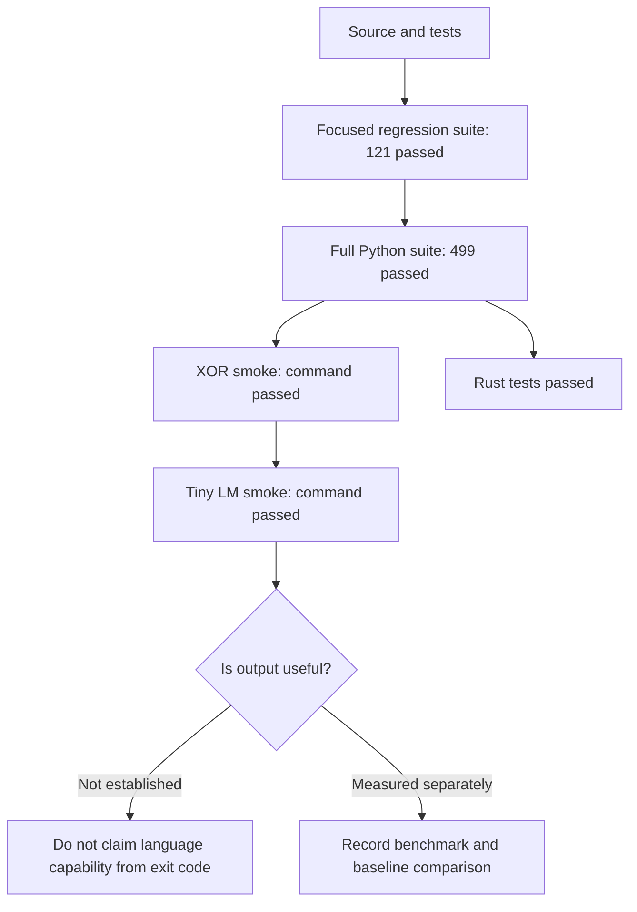

### Capability reality check — source code vs. verified behavior

| Area | Repository evidence | What is not established |
|---|---|---|
| Cognitive modules | Memory, perception, reasoning, planning, reflection, task scheduling | Reliable success on arbitrary complex tasks |
| LLM providers | Optional local Ollama/Llama provider and provider interfaces | Provider availability without local configuration, model, or credentials |
| Persistent memory | Explicit remember/learn/forget workflow | Updating model weights or learning correct facts automatically |
| Teacher data and training | Candidate dataset generation, training/checkpoint and evaluation workflows | Dataset correctness or measurable intelligence improvement without evaluation |
| Voice | Optional ElevenLabs speech output | Working voice without API access and configuration |
| Self-Developer | CLI, isolated candidate worktree, guarded patch application, bounded validation/retries, rollback and report retention | Perfect bug discovery, independent proof of correctness, or safe arbitrary-code sandboxing |
| GitHub write actions | Current Self-Developer documents and code avoid automatic push/merge | Automatic push or merge is not part of the current Self-Developer workflow |

### Next engineering actions

1. Keep PR #8 unmerged. Review the final diff and run focused/full validation on the user's actual Windows checkout while preserving user-owned files and data.
2. Treat the successful Ubuntu CI run as a meaningful milestone, not as proof of Windows behavior or real-world autonomy.
3. Synchronize and revalidate the stacked research/cleanup branches (#9 and #10) against the accepted Self-Developer base; their older CI runs had Python failures and are not current green evidence.
4. Improve the Tiny LM evaluation so a successful process exit cannot be mistaken for useful generation: record a reproducible held-out metric and compare against a baseline before making quality claims.
5. Only after review, design any future GitHub push capability as a separate, explicitly authorized feature: dedicated branch/PR, required checks, least-privilege token, audit log, and no automatic merge.
6. Preserve `checkpoints/`, `outputs/`, conversation JSONL/manifest files, and `test_voice.py`. Never merge a PR without the user's explicit approval.

---

## Master remaining-work inventory — 2026-10-15

This is the consolidated remaining-work checklist based on the current README handoff, Self-Developer documentation, AI ecosystem research roadmap, and known pull-request/CI records. It is not a claim that every conceivable future improvement can be predicted. Update checkboxes only when evidence is available.

### A. Immediate acceptance gates — do these first

- [ ] **A1. Verify current branch head and CI.** Recheck the latest head of `feature/tara-self-developer-v1`, inspect workflow results and confirm whether README-only commits have a completed run. The last verified code-bearing CI snapshot is run [#38615254519](https://github.com/deathkernel/TARA/actions/runs/38615254519), on commit `19fc99df7d73584d98be9b549a15ce95fb08a94b`.
- [ ] **A2. Run the documented focused tests on the actual Windows checkout**, including Self-Developer, CLI, teacher-distillation and repository-audit tests. Record exact command output; do not imply Ubuntu CI is Windows validation.
- [ ] **A3. Run the full Python suite on Windows** and record pass/fail counts, duration and environment. Preserve the user's branch, untracked files and local artifacts.
- [ ] **A4. Review PR #8's final diff and candidate lifecycle**: patch guards, symlink/external-file protection, intent-to-add/ignored artifacts, timeout, retry limit, rollback, candidate cleanup, atomic report persistence, candidate retention, and report accuracy.
- [ ] **A5. Review all open PRs and branch dependencies** before integration. Keep PRs draft/open/unmerged until the user explicitly approves; do not merge as part of automated cleanup.
- [ ] **A6. Preserve protected user data:** `checkpoints/`, `outputs/`, conversation JSONL/manifest files and `test_voice.py`. Never run destructive cleanup against the original working tree.

### B. Self-Developer — make controlled code improvement trustworthy

- [ ] **B1. Prove bug reproduction:** require a failing regression test or an explicit, reproducible failure before claiming a bug has been identified.
- [ ] **B2. Verify repair quality:** require the new regression test to fail before the fix and pass after it where feasible; also run relevant existing tests.
- [ ] **B3. Review retry and failure reports** for all terminal states, including provider errors, malformed patches, rejected paths, validation failures, timeout, rollback failure, cleanup failure and report-write failure.
- [ ] **B4. Add/finish adversarial tests** for malicious patch paths, symlink escape, protected artifacts, ignored files, nested Git metadata, Windows-invalid paths, unsafe file modes and dependency/workflow modifications.
- [ ] **B5. Add a real execution boundary.** A Git worktree isolates edits but is not a hostile-code sandbox. Design and test least-privilege execution with restricted mounts, secrets unavailable, network policy, CPU/RAM/time ceilings and a Windows-first implementation or clearly documented Windows-compatible option.
- [ ] **B6. Keep fixed validation commands and bounded output/timeouts.** Do not let generated model text choose arbitrary shell commands, install dependencies or widen its own permissions.
- [ ] **B7. Add human-readable diff/review UX** with changed paths, validation commands/results, risks, report location and explicit approval state.
- [ ] **B8. Keep current default safe:** no automatic integration, push or merge. Only design a future push feature after review and acceptance gates are defined.
- [ ] **B9. If authorized later, implement supervised push as a separate feature:** dedicated branch, least-privilege credential, required checks, audit log, explicit opt-in, no automatic merge and fail-closed behavior. Never expose secrets to generated code.
- [ ] **B10. Add end-to-end acceptance tests** proving the CLI can go from task → candidate → validation → retained report, without changing the original checkout.

### C. Pull requests and branch hygiene

- [ ] **C1. PR #8 — Self-Developer v1:** review final code/diff and complete Windows validation; retain manual approval boundary.
- [ ] **C2. PR #9 — AI ecosystem research:** sync its base with the accepted upstream branch as appropriate, rerun CI, verify documentation links and roadmap claims, and review its complete diff.
- [ ] **C3. PR #10 — unused-component cleanup:** rebase/sync only after dependency/base decisions, rerun full CI, verify deletions and ensure the custom model/training/benchmark/Polyglot stack and protected artifacts remain intact.
- [ ] **C4. PR #11 — parallel pytest experiment:** compare two-worker runtime with serial baseline; verify no shared-state races, flaky tests, resource pressure or lost coverage. Revert if no meaningful benefit.
- [ ] **C5. PR #6 — persistent conversation memory:** verify it is included in the intended integration sequence, run targeted and full tests, inspect privacy/path behavior and review the diff.
- [ ] **C6. PR #7 — teacher distillation:** verify generation, overwrite protection, provenance, audit and dataset-review workflow; run targeted and full tests before integration.
- [ ] **C7. PR #5 and other older branches/PRs:** decide whether their provider/voice work is already present in the intended base, obsolete, or still needs integration. Avoid duplicate or conflicting provider implementations.
- [ ] **C8. Resolve stacked-PR order explicitly.** Document each PR's base, dependency and merge order; rerun CI after any rebase/base change.
- [ ] **C9. Review remaining branches** such as checkpoint-preservation, upstream-integration and algorithm-loop branches. Classify each as active, superseded, archive-only or candidate for a separately reviewed PR; do not bulk-merge branches.
- [ ] **C10. Confirm default-branch status** after user approval and only then mark accepted PRs complete. Keep README handoff and diagrams synchronized with actual repository state.

### D. Model providers and inference reliability

- [ ] **D1. Define one provider contract** for completion, timeout, normalized errors, selected-model reporting, availability/health status and usage metadata.
- [ ] **D2. Add deterministic provider tests** for valid and malformed responses, connection failures, timeouts, environment parsing, model selection and fallback behavior.
- [ ] **D3. Test Ollama locally** with the configured `llama3.2:3b` model; record model availability, latency, timeout and response behavior.
- [ ] **D4. Test optional external providers** only with explicitly configured credentials; confirm failures do not leak secrets or falsely report success.
- [ ] **D5. Document cost/privacy/network behavior** for every external provider and preserve local inference as an explicit option.
- [ ] **D6. Benchmark Ollama vs llama.cpp** before any runtime switch, recording hardware/software, first-token latency, tokens/sec, peak RAM/VRAM, context length, compatibility, error rate and output quality.
- [ ] **D7. Do not auto-download models or start services silently.** Any model install, large download or external call must be explicit and observable.

### E. Tools, permissions and execution safety

- [ ] **E1. Inventory existing `src/tools/` and `SafetyPolicy`** and reuse them rather than introducing a duplicate tool system.
- [ ] **E2. Standardize tool metadata:** stable name, description, argument schema, permission, side-effect class, timeout/resource limits and result/error format.
- [ ] **E3. Route every tool call through one default-deny policy gate** and create an auditable event for allow/deny/result.
- [ ] **E4. Require explicit confirmation** for destructive or externally visible actions: deletion, sending/publishing, settings changes, risky host commands, commits, pushes and merges.
- [ ] **E5. Add negative tests** for denied calls, malformed arguments, repeated calls, timeouts, partial failures, forged model requests and audit-write errors.
- [ ] **E6. Verify generated code remains fail-closed on the host.** Code execution that is required for an evaluation must use an explicitly injected isolated backend.
- [ ] **E7. Test permissions end-to-end** so an untrusted model response cannot gain host capabilities merely by naming a tool.

### F. Memory, retrieval and user-controlled data

- [ ] **F1. Define memory scopes:** global preferences, project facts, session state and task-run history must not be accidentally mixed.
- [ ] **F2. Add provenance where useful:** timestamps, source references, confidence/status and origin of each durable fact.
- [ ] **F3. Test persistent memory on the target OS** for save, restart, retrieval, list, export, forget/delete and custom path handling.
- [ ] **F4. Ensure secrets and sensitive content are not silently persisted or included in logs.**
- [ ] **F5. Build a small retrieval benchmark** with known expected results before adding a vector database or RAG framework.
- [ ] **F6. Add source-grounded answers and citations** for document retrieval; test deletion/forget behavior and stale-source handling.
- [ ] **F7. Only then evaluate AnythingLLM/Dify-style document connectors**; keep one canonical memory/retrieval contract rather than fragmented stores.

### G. Teacher data, training and checkpoint lifecycle

- [ ] **G1. Test teacher generation and read-only audit** on valid, malformed, duplicate, corrupt-UTF-8 and missing files.
- [ ] **G2. Manually review/curate teacher answers** for factuality, code correctness, safety, duplication and usefulness; structural audit alone is insufficient.
- [ ] **G3. Keep train/validation/test data separated** and prevent benchmark/test contamination in generated or curated training data.
- [ ] **G4. Run an explicit small training experiment** only on a reviewed dataset and a separate candidate checkpoint.
- [ ] **G5. Compare baseline and candidate on held-out evaluations** with reproducible seeds, data fingerprints and recorded hardware/configuration.
- [ ] **G6. Verify checkpoint resume/recovery** and that interrupted/failed training cannot overwrite the best known-good checkpoint.
- [ ] **G7. Complete the checkpoint-preservation audit** on branch `audit/preserve-best-validation-checkpoint`; verify best-validation checkpoint selection, resume determinism, promotion gates and failure recovery before integrating it.
- [ ] **G8. Test CPU fallback and CUDA compatibility** on supported environments; do not require NVIDIA/CUDA setup as a side effect.
- [ ] **G9. Profile memory/throughput and consider AMP only with numerical regression tests** and measured benefit.
- [ ] **G10. Do not promote a checkpoint automatically** unless explicit measurable gates pass and the promotion workflow has been reviewed/authorized.

### H. Model quality and evaluation — high priority

- [ ] **H1. Fix the Tiny LM acceptance gap:** smoke command success is not quality. Add a reproducible held-out metric and compare with a baseline.
- [ ] **H2. Establish baseline scores** for coding, reasoning, memory retrieval, tool selection, safety-denial and task completion.
- [ ] **H3. Track regression across commits** with stable benchmark cases and fingerprints.
- [ ] **H4. Separate syntax/compilation, unit tests, task success and output quality** in reports; never collapse them into one generic “passed”.
- [ ] **H5. Report uncertainty and failed cases** rather than presenting only aggregate scores.
- [ ] **H6. Ensure model-evaluation reports identify the checkpoint, dataset, model/provider, configuration, seeds and software version.**
- [ ] **H7. Measure actual end-to-end task completion** and verify side effects; fluent text or a zero exit code alone is insufficient.
- [ ] **H8. Avoid claims of general intelligence or human-level reasoning** without an appropriate, reproducible evaluation.

### I. Cognitive loop, planner and observability

- [ ] **I1. Retain regression tests for the dependency-aware scheduler** and verify multi-step plans progress beyond the first ready step.
- [ ] **I2. Test cognitive-loop/core end-to-end paths** for empty plans, dependencies, retries, cancellation, tool failures and incomplete verification.
- [ ] **I3. Trace task IDs, plan revisions, tool decisions, provider latency/errors, validation outcomes and final results.**
- [ ] **I4. Redact secrets and sensitive user data from traces and reports.**
- [ ] **I5. Make failure reasons explicit** so “no action”, “denied”, “timeout”, “provider unavailable” and “task completed” cannot be confused.
- [ ] **I6. Add deterministic replay/regression fixtures** for previously failing orchestration and scheduler cases.

### J. Voice, chat UX and interfaces

- [ ] **J1. Verify local chat on Windows** with Ollama running and a model installed; check clear errors when unavailable.
- [ ] **J2. Test ElevenLabs TTS with explicitly configured credentials** and document provider/model/voice/output-format errors.
- [ ] **J3. Keep secrets and voice configuration out of Git.**
- [ ] **J4. Decide whether a stable API/session/auth boundary is needed** before considering Open WebUI or another UI.
- [ ] **J5. Keep CLI and core functional without an optional web UI.**
- [ ] **J6. Add UI only for a concrete use case and with acceptance tests; do not build UI merely because an ecosystem project offers one.**

### K. Optional AI ecosystem integrations — after core contracts stabilize

- [ ] **K1. MCP exposure:** define schemas, permissions, confirmations and audit logging; expose only selected TARA capabilities.
- [ ] **K2. n8n:** consider a narrow webhook/event adapter only when a concrete automation requirement exists; review current licensing/terms before reuse or redistribution.
- [ ] **K3. Langflow/Dify:** evaluate as optional prototypes or external services, not as a second TARA orchestrator.
- [ ] **K4. Open WebUI:** consider only after stable API, authentication and session boundaries; review extensions as potentially executable server code.
- [ ] **K5. AnythingLLM:** consider only for a defined document/RAG requirement after retrieval contracts and evaluations exist.
- [ ] **K6. Agent Zero, AutoAgent and OpenHands:** continue design comparisons; do not run several competing autonomous controllers inside TARA.
- [ ] **K7. Check current licenses and third-party dependencies** before copying code, vendoring components or redistributing integrations.
- [ ] **K8. Keep heavy/optional dependencies lazy and optional** so core CPU/local operation does not require every ecosystem runtime.

### L. CI, performance and release engineering

- [ ] **L1. Revalidate latest README commits and branch head**; record the exact tested commit SHA and CI URL.
- [ ] **L2. Preserve static repository audit, focused tests, full Python suite, smoke tests and Rust tests** as distinct checks.
- [ ] **L3. Evaluate PR #11 parallel test trial against the serial baseline**; retain only if reliable and measurably faster.
- [ ] **L4. Record slow tests and reduce runtime without deleting or weakening regression coverage.**
- [ ] **L5. Ensure path filters/concurrency do not silently skip required checks** or cancel the only relevant validation run.
- [ ] **L6. Add supported Python/OS compatibility coverage** based on actual project requirements, especially Windows behavior.
- [ ] **L7. Document reproducible setup, environment variables, CLI commands, test commands, failure recovery and known limitations.**
- [ ] **L8. Review dependency security and pinning** before changing or adding dependencies.
- [ ] **L9. Produce a release checklist** for versioning, changelog, tests, protected-data checks, documentation and rollback plan.

### M. Documentation and project handoff

- [ ] **M1. Update this checklist after each meaningful task** and mark an item complete only with a commit/test/evaluation reference.
- [ ] **M2. Keep previous work → current state → next action in README**, including Mermaid diagrams.
- [ ] **M3. Record the exact CI-tested commit, not just a branch name.**
- [ ] **M4. Keep “implemented”, “executed”, “measured” and “approved for integration” as separate statuses.**
- [ ] **M5. Keep setup instructions aligned with the branch that actually contains the commands/modules.**
- [ ] **M6. Maintain a decisions/deferred-work section** so optional integrations do not accidentally become mandatory scope.

### Recommended order

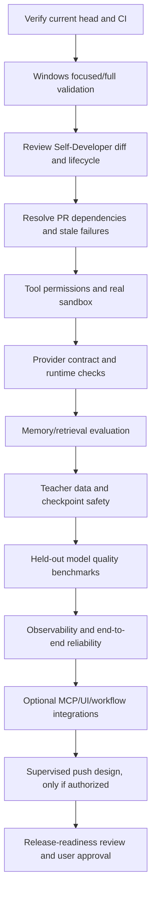

### Definition of done for a future “TARA ready” claim

- [ ] Required CI passes on the exact candidate commit.
- [ ] Windows focused/full tests are recorded on the intended supported environment.
- [ ] Critical permissions, secret handling, protected-data and sandbox tests pass.
- [ ] Provider, memory, tools, training and voice claims have relevant runtime evidence.
- [ ] Model-quality claims have reproducible held-out baseline comparisons.
- [ ] All intended PR dependencies and diffs are reviewed.
- [ ] User explicitly approves integration; no PR is merged by implication.


## Live repository audit and bulk-progress snapshot — 2026-10-15

> This snapshot supersedes older CI statements below where the same PR/head now has newer evidence. It is a GitHub-hosted repository audit, not a claim that the Windows working copy was tested. Keep PRs unmerged until the user explicitly approves integration.

### Verified branch / PR graph

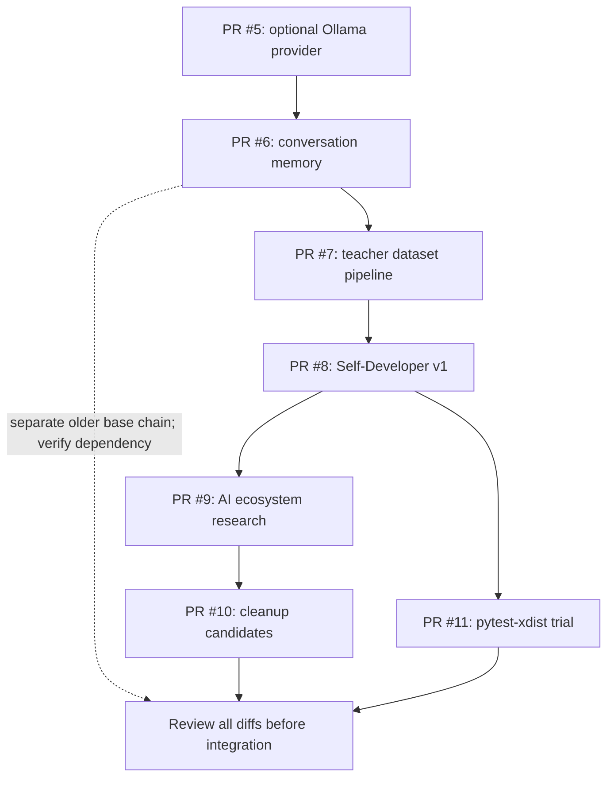

- PR #6 is based on `feature/local-llama-ollama-backend`; PR #7 is based on PR #6's branch; PR #8 is based on PR #7's branch; PR #9 is based on PR #8's branch; PR #10 is based on PR #9's branch. This is a stacked chain, so each base/head must be reviewed in order and synchronized deliberately.
- PR #11 is a separate CI experiment based on an older PR #8 head (`19fc99d`), so its result does not validate the current PR #8 commit.
- Current PR #6–#11 snapshots are open, draft, and unmerged. The connector reports them as mergeable, but that is not a substitute for CI, review, or user approval.

### Newer CI evidence (exact heads only)

| PR | Head commit | Latest observed run | Evidence / status |
|---|---|---|---|
| #6 | `32dec8730ff63938fe56ec26ae50d41efcdcd0d9` | [#38434430200](https://github.com/deathkernel/TARA/actions/runs/38434430200) | Python suite failed; Rust passed. Stale base chain needs diagnosis/retest. |
| #7 | `641faa150af4737a29a22d90d0dbbb4c3651b98b` | [#38434787693](https://github.com/deathkernel/TARA/actions/runs/38434787693) | Python suite failed; Rust passed. Stale base chain needs diagnosis/retest. |
| #8 | `3a53ef2c868cf8ca3be381af24f5ef4ed76d1b2b` | [#38683205509](https://github.com/deathkernel/TARA/actions/runs/38683205509) | Rust passed; Python job was still running at last check (dependency installation step). Do not call the full run green yet. |
| #9 | `059062a091663d556657e7c893a3e5ab7f7c28a6` | [#38616099162](https://github.com/deathkernel/TARA/actions/runs/38616099162) | Python and Rust jobs passed on this exact head. Still review branch freshness/base relationship and docs claims. |
| #10 | `2d32dda3d5c8becb88654c90f12f9e27ab73a8b5` | [#38616218993](https://github.com/deathkernel/TARA/actions/runs/38616218993) | Python and Rust jobs passed on this exact head. Still review cleanup diff carefully before integration. |
| #11 | `d5dd719374cda63bb23fead3cd833a2d4b20e194` | [#38615869611](https://github.com/deathkernel/TARA/actions/runs/38615869611) | Static audit and focused tests passed; bounded parallel full-suite step was cancelled; smoke steps skipped. Performance experiment is inconclusive, not a pass. |

### Bulk audit decisions

- [x] Verify current PR #8 head SHA and inspect latest run/job state.
- [x] Check the open/draft/unmerged state of PRs #6–#11 and record their stacked bases.
- [x] Replace stale blanket statements that PR #9/#10 still have only failing CI with the newer successful exact-head run evidence above.
- [x] Record PR #11 as inconclusive because the full parallel suite was cancelled.
- [ ] Diagnose Python failures on PR #6 and #7 using exact failed test output; do not infer root cause from the red status alone.
- [ ] Wait for PR #8 run #1177 to finish, then capture job-level results and exact test counts.
- [ ] Re-run/refresh PR #6/#7 only after confirming intended stacked base commits; avoid rebasing or retargeting branches without checking dependent PR diffs.
- [ ] Benchmark PR #11 against a serial baseline with comparable runner conditions; retain xdist only if it is reliable and materially faster.
- [ ] Review PR #10 deletion candidates against imports, tests, scripts, docs and user artifacts before approving cleanup.
- [ ] Run documented focused and full tests on the actual Windows checkout; GitHub Ubuntu CI is not a substitute.
- [ ] Explicitly inspect protected data and untracked artifacts on the user's real checkout; the GitHub connector cannot prove local filesystem preservation.
- [ ] No PR merged, closed, retargeted, or rebased during this audit.

### Next bulk execution order

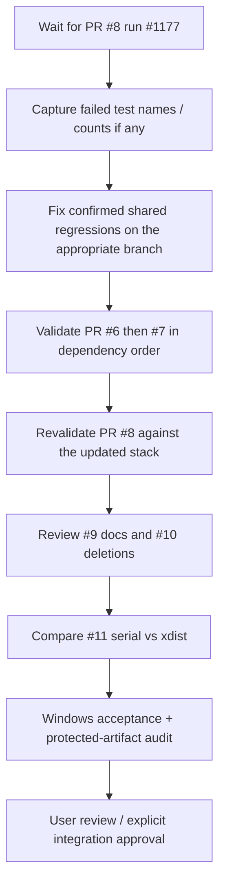

**Important limitation:** GitHub metadata and job status alone do not expose the complete failed pytest output in this connector response. Root-cause fixes require retrieving logs or reproducing locally; do not mark those tasks done until actual failure details are available.


## Historical failure signatures — PR #6 / PR #7 (log-backed, 2026-10-15)

Fetched the actual Python job logs for [PR #6 run #38434430200](https://github.com/deathkernel/TARA/actions/runs/38434430200) and [PR #7 run #38434787693](https://github.com/deathkernel/TARA/actions/runs/38434787693). Both Python jobs failed while their Rust jobs passed. The failures are highly overlapping and point to pre-existing/shared integration regressions; this is evidence for triage, not proof that every root cause is already understood.

- PR #6 exact summary: **18 failed, 400 passed**.
- PR #7 exact summary: **18 failed, 403 passed**.
- Shared failure signatures captured from both logs:
  - Continual-learning export: `Candidate` is not JSON serializable (two tests).
  - Dataset acquisition: expected module-import behavior differed (`assert 0 == 1`).
  - Evaluation orchestrator: missing `CheckpointEvaluator.overall_tolerance` (two tests); test factory lambda signature mismatch (one test).
  - Improvement gate: category regression (memory) not detected in a benchmark scenario.
  - Small language model capacity profile: expected embedding parameter count 16 but observed 512.
  - Learning experiment: candidate checkpoint lookup raised `KeyError` for a temporary `candidate.pt` path.
  - Model adapter: expected `src.polyglot.model_adapter.load_checkpoint` attribute was absent.
  - Capability runner: fake model did not expose `eval()` expected by the runner.
  - Image perception: PNG metadata fixture was rejected as unsupported (expected PNG or JPEG).
  - Scheduler retry: retry event left report pending rather than failed.
  - Self-improvement benchmark: candidate was not verified because host process execution was disabled by TARA's safety boundary.
  - TARA Core and unified cognitive loop: end-to-end cycle did not complete.
  - Transformer gradient check: tiny gradients produced a relative-error mismatch.
  - Unified cognitive loop tool selection: a string was used where an object with `.tool` was expected.
- These logs are from older heads and must not be treated as the current state of PR #8. Several subsequent commits may have changed the relevant modules. The current PR #8 full suite is still running; compare its final failure list before selecting fixes.
- Avoid broad fixes that weaken safety (especially host-process execution restrictions) just to satisfy a test. Where the test assumes execution, either use a properly constrained test double/sandbox or adjust the expectation to match the intended policy.

### Triage order for the shared failure family

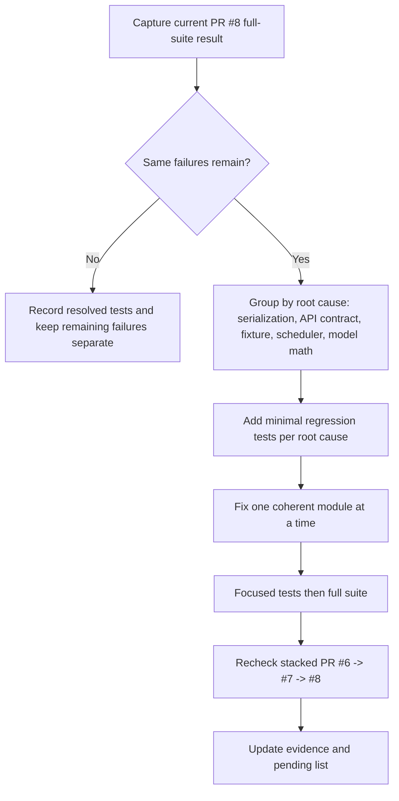
