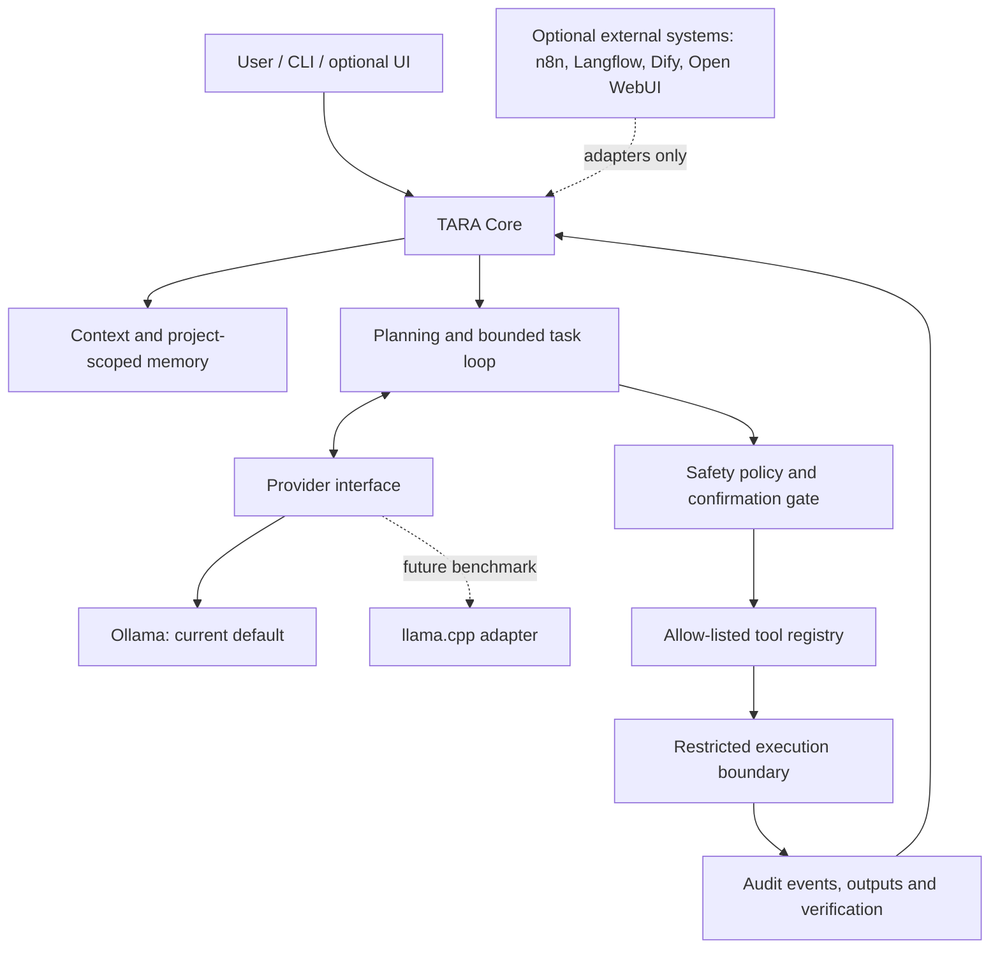

# TARA AI Ecosystem Research and Adoption Plan

**Research date:** 2026-10-14  
**Scope:** Architecture and integration patterns from the ten user-supplied GitHub projects.  
**Decision type:** Research-backed roadmap; not a decision to install or embed any full framework.

## Executive decision

**Keep TARA as the owner of identity, orchestration, memory policy, planning, permissions, tool execution, verification, learning, and final decisions.** Use external projects as references or optional adapters, not as competing brains inside TARA.

The repository already contains useful foundations: `src/llm_provider_factory.py`, `src/ollama_provider.py`, `src/agent.py`, `src/safety.py`, `src/tools/`, `src/task_scheduler.py`, and the review-gated `src/self_developer.py`. The highest-value work is to harden and connect these existing components, prove behavior with tests, then add optional interfaces only where there is a demonstrated need.

The current local-model decision remains **Ollama serving `llama3.2:3b`**. Do not swap to llama.cpp or another runtime without a measured comparison. A provider adapter may change the model transport; it must not transfer TARA's identity or decision authority to the runtime.

## What each project can teach TARA

| Project | Primary role in its own ecosystem | What TARA should learn or optionally reuse | Decision |
|---|---|---|---|
| [Agent Zero](https://github.com/agent0ai/agent-zero) | General agent framework with project workflows, tools, skills, and persistent memory concepts | Project-scoped context, understandable tool/extension boundaries, memory curation and explicit operator visibility | **Study patterns; do not import the whole framework.** TARA already has its own cognitive loop and memory modules. |
| [Open WebUI](https://github.com/open-webui/open-webui) | Self-hosted chat interface for local and API-backed models, with an extension ecosystem | Potential optional front end once TARA exposes stable, documented endpoints; useful reference for model selection and chat UX | **Optional UI later.** Keep the existing CLI and core usable without a web UI. Review every extension: its official docs warn that Functions can execute arbitrary Python on the server and should be restricted to trusted/admin-reviewed code. |
| [n8n](https://github.com/n8n-io/n8n) | Workflow automation, integrations, multi-step execution, approvals, and execution observability | Event/webhook adapters, explicit workflow states, human-approval steps, and auditable run histories | **Optional integration adapter later.** Do not duplicate TARA's scheduler/orchestrator in the core. Its repository describes itself as fair-code; review current license/terms before adopting code or redistributing it. |
| [Langflow](https://github.com/langflow-ai/langflow) | Visual authoring for AI flows; exposes workflows through APIs and as MCP servers | Visual prototyping and black-box integration boundary; useful for testing proposed flows without making a visual editor mandatory | **Integration/reference only after core contracts stabilize.** Never make TARA's run-time behavior depend on a visual-builder service. |
| [AutoAgent](https://github.com/HKUDS/AutoAgent) | Natural-language-driven agent construction and automation | Study task decomposition, tool discovery and agent-evaluation design; compare its workflow against TARA's bounded plan/execute/verify loop | **Research benchmark, not a runtime dependency.** Do not adopt unrestricted self-modification or broad tool access just to gain autonomy. |
| [Dify](https://github.com/langgenius/dify) | LLM application platform spanning workflows, RAG, agent capabilities, model management and observability | Reference for source ingestion, retrieval evaluation, workflow diagnostics and deployment boundaries | **Use as a reference or external service if needed.** Avoid adding a second central orchestrator or a duplicate RAG database before TARA has a defined retrieval requirement. |
| [OpenHands](https://github.com/OpenHands/OpenHands) | Software-development agents and supporting server/sandbox architecture | Strong benchmark for separating code agents from the user's host, disposable workspaces, explicit runtime boundaries, and reviewable task events | **Prioritize its sandboxing lessons.** Do not pull its full application stack into TARA. A Git worktree isolates source edits but is not a security sandbox. |
| [AnythingLLM](https://github.com/Mintplex-Labs/anything-llm) | Local-first document chat, workspaces, retrieval, citations and agent integrations | Project/workspace-scoped knowledge and source-grounded answers with citations and deletion controls | **Potential document/RAG adapter later.** First define one canonical TARA memory/retrieval contract so knowledge stores do not fragment. |
| [Ollama](https://github.com/ollama/ollama) | Local model lifecycle and inference API | Keep the existing provider adapter; explicitly report selected model, availability, latency, timeout and provider errors | **Keep as the default local runtime.** Do not auto-download models or start background services as a hidden side effect. |
| [llama.cpp](https://github.com/ggml-org/llama.cpp) | Efficient CPU/GPU inference, quantized GGUF models and an HTTP server with OpenAI-compatible endpoints | Candidate alternative backend; use the same provider contract and compare latency, throughput, memory, compatibility and output quality | **Benchmark only; no switch now.** Treat it as an optional backend, not as TARA's cognitive architecture. |

## Recommended TARA boundary

The external systems should not bypass TARA's policy checks. Every route into host tools must be permission-checked, bounded by time/resource limits where applicable, recorded, and verified. An external UI, workflow editor, or model server is a client/runtime—not the authority that decides what TARA is allowed to do.

## Prioritized implementation roadmap

### P0 — Finish current validation before widening scope

1. Let the current Self-Developer PR's active Python suite and smoke experiments reach terminal results.
2. Fix only evidenced failures and rerun affected plus full CI checks as appropriate.
3. Keep PR #8 draft and unmerged until the user approves integration. Do not treat source inspection as test success.
4. Continue to protect local/user artifacts and keep the research work separate from the active run.

**Exit gate:** full CI outcome is recorded accurately; any failure has a reproducible cause or documented blocker.

### P1 — Stabilize the existing model-provider contract

1. Document a small provider contract for completion, timeout, error normalization, selected-model reporting, and an optional health/availability check.
2. Add deterministic tests for valid responses, malformed responses, connection errors, timeouts, environment-variable parsing, and provider selection using the existing injected transport.
3. Keep `llama3.2:3b` as default and preserve the explicit opt-in to external inference.
4. Do not add new inference dependencies or model downloads merely to perform a health check.

**Exit gate:** tests run without an installed model or a live service; live smoke test is a separate explicitly labeled check.

### P2 — Make tool use auditable and default-deny

1. Inventory the existing `src/tools/` and `SafetyPolicy` rather than writing a second tool system.
2. Standardize tool metadata: stable name, description, argument schema, required permission, side-effect class, timeout/resource limit, and result/error format.
3. Route every execution through a single policy gate and audit record.
4. Require explicit confirmation for destructive or externally visible operations (deletion, sending/publishing, commits/pushes/merges, changing settings, or running risky host commands).
5. Test denial paths, malformed arguments, repeated calls, timeouts, failed actions, and audit persistence before adding broader autonomy.

**Exit gate:** an untrusted model response cannot invoke a host capability simply by naming it; a denied or malformed tool call performs no action.

### P3 — Harden execution isolation, especially for self-development

1. Keep generated edits in a dedicated candidate workspace, with a small path allow-list, fixed validation commands, output limits, and reviewable diffs.
2. Specify a real execution boundary separately from Git worktrees (for example, a least-privilege container or disposable worker with restricted mounts, network policy, resource ceilings, and no access to user secrets). Design a Windows-first option explicitly rather than assuming Linux container behavior maps perfectly.
3. Keep the original user checkout and files out of candidate cleanup. Never run destructive cleanup against the original checkout.
4. Require human review before candidate integration. Do not permit the agent to grant itself permissions, weaken its policy, alter protected CI, or silently push/merge.

**Exit gate:** adversarial tests demonstrate that candidate code cannot read protected/external files or exceed the explicitly granted execution boundary. Git worktree-only protection is not enough for this claim.

### P4 — Unify memory and retrieval contracts before adding RAG products

1. Define scopes: global preferences, project facts, conversation/session state, and task-run history should not be accidentally mixed.
2. Store provenance, timestamps, source references, and confidence where useful; support inspect, export, forget/delete, and an opt-in policy for durable writes.
3. Build a small retrieval evaluation set before choosing or adding a vector store.
4. Only then consider a connector inspired by AnythingLLM/Dify for document ingestion and cited answers; avoid maintaining competing memory copies.

**Exit gate:** answers can show their retrieved sources, and delete/forget behavior is covered by tests.

### P5 — Add evaluations and observability to real user-visible flows

1. Trace task IDs, plan revisions, tool decisions, provider latency/errors, validation results and final outcomes without logging secrets.
2. Create a small repeatable benchmark for chat/tool selection, memory retrieval, coding tasks and safety-denial behavior.
3. Track regressions against the existing local-model baseline before changing prompts, model, or orchestration.
4. Separate successful generation from successful task completion. A fluent answer is not evidence that an action worked.

**Exit gate:** benchmark and run reports make it possible to compare changes instead of relying on impressions.

### P6 — Add integrations only after core contracts are stable

- **MCP/tool exposure:** define permissions and schemas first; expose only selected TARA capabilities, not the whole host.
- **n8n:** add a narrow webhook/event adapter if real external automation requirements appear.
- **Langflow/Dify:** use as optional flow prototypes or external integrations when a concrete workflow warrants it.
- **Open WebUI:** add only after a stable API/session/authentication boundary exists; treat it as an interface, not as the source of truth.
- **AnythingLLM:** consider only for a well-defined document knowledge use case.
- **Agent Zero/AutoAgent/OpenHands:** continue to compare design choices; do not deploy several competing autonomous controllers inside one TARA process.

### P7 — Evaluate llama.cpp against Ollama using evidence

Run the same representative tasks and model/configuration where technically comparable. Record hardware/software versions, first-token latency, tokens/second, peak RAM/VRAM, context length, structured-output/tool compatibility, error rate and response quality. Make the backend optional only if the measured result improves a user-relevant constraint without breaking tests. Keep the selected `llama3.2:3b` model decision separate from the runtime decision.

## Non-goals and guardrails

- No wholesale fork/import of any of the ten frameworks.
- No extra web UI, workflow engine, vector database, or MCP server until a specific use case and acceptance test exist.
- No automatic software installation, model download, secret access, host command, push, merge, or integration triggered solely by generated text.
- No license assumption based on a project being popular or publicly visible; review current licenses and third-party dependencies before copying code or distributing it. In particular, n8n describes itself as fair-code.
- No declaration that a module is operational just because a file exists; check wiring, permissions, runtime behavior and tests.

## Official research sources

All sources below are the projects' own repositories or official documentation, checked for this comparison on 2026-10-14. This report summarizes capabilities and patterns; it is not a full security audit, license opinion, or exhaustive line-by-line review.

1. [Agent Zero repository and docs](https://github.com/agent0ai/agent-zero)
2. [Open WebUI repository](https://github.com/open-webui/open-webui) · [official extension security note for Functions](https://github.com/open-webui/docs/blob/main/docs/features/extensibility/plugin/functions/index.mdx)
3. [n8n repository and README](https://github.com/n8n-io/n8n)
4. [Langflow repository and README](https://github.com/langflow-ai/langflow)
5. [AutoAgent repository and README](https://github.com/HKUDS/AutoAgent)
6. [Dify repository and README](https://github.com/langgenius/dify)
7. [OpenHands repository](https://github.com/OpenHands/OpenHands) · [official sandbox guide](https://github.com/OpenHands/docs/blob/main/openhands/usage/advanced/custom-sandbox-guide.mdx)
8. [AnythingLLM repository and README](https://github.com/Mintplex-Labs/anything-llm)
9. [Ollama repository and REST API example](https://github.com/ollama/ollama)
10. [llama.cpp repository](https://github.com/ggml-org/llama.cpp) · [official HTTP server API documentation](https://github.com/ggml-org/llama.cpp/blob/master/tools/server/README.md)

## Relationship to current TARA work

- The provider adapter and factory already exist: [`src/ollama_provider.py`](../src/ollama_provider.py), [`src/llm_provider_factory.py`](../src/llm_provider_factory.py).
- TARA has an explicit cognitive loop: [`src/agent.py`](../src/agent.py), plus core/runtime components.
- Permission and confirmation primitives exist: [`src/safety.py`](../src/safety.py).
- Controlled code modification exists but still needs successful CI and a separate host-level sandbox guarantee: [`src/self_developer.py`](../src/self_developer.py).
- This research report is a design input, not a claim that every adapter or roadmap item has been implemented.
