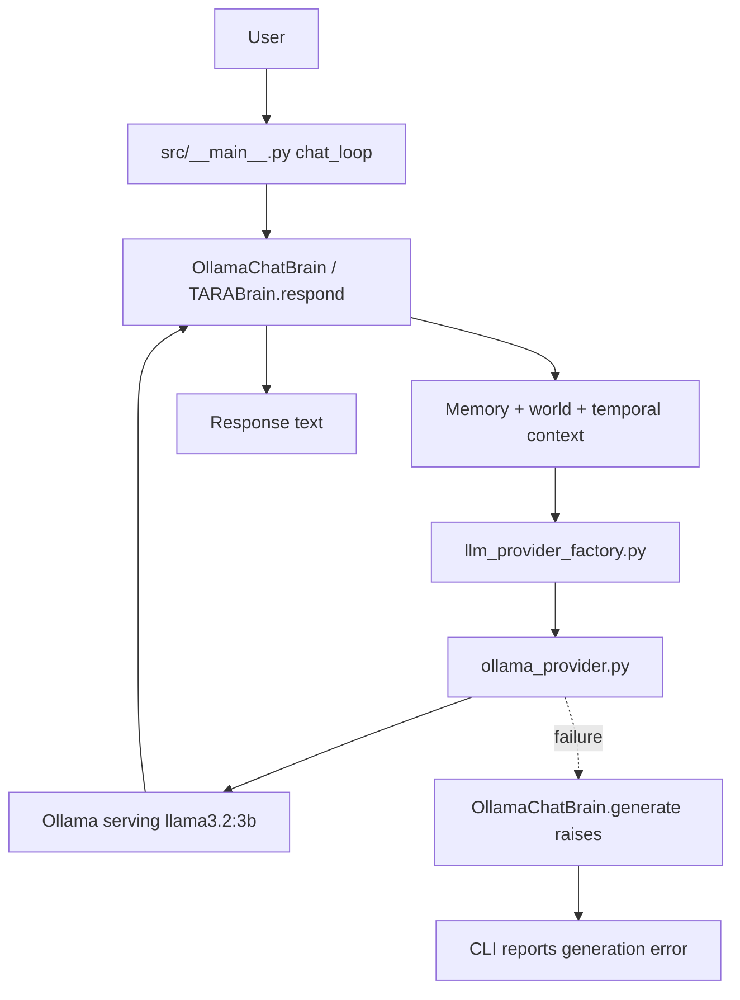

# Llama Connection: Deep File Cleanup Audit

**Audit date:** 2026-10-14  
**Audit target:** TARA's Llama/Ollama-enabled chat architecture and its surrounding training/research repository.  
**Baseline inspected:** `feature/tara-self-developer-v1`, reported head `804798f25a35c2c907ed6a9bbeeace5637739de2`; cross-checked against the current branch's source files, tests, README and repository searches.  
**Status:** Cleanup implemented on the isolated branch `cleanup/llama-unused-components`; changes are proposed for review and are not merged. Static reference inspection supports the selected removals. The full local test suite has not been run; CI validation is pending.

## Executive result

**Cleanup has been applied on the isolated branch `cleanup/llama-unused-components`; this is a proposed change, not an integration into TARA's active branch.** The repository reference search found no production imports for the alternate `BasicTARABrain` baseline, no provider-factory path for Groq, and no references to the duplicate accelerated requirements file. The Groq import in `src/brain.py` was unused.

Removed as one cleanup change:
- `src/basic_brain.py` and `tests/test_basic_brain.py` — alternate baseline only referenced by its own tests; it was not part of the active CLI/provider path.
- `src/groq_provider.py`, `tests/test_groq_provider.py`, the unused `GroqProvider` import in `src/brain.py`, and `groq` from `requirements.txt` — current provider factory supports Ollama/Llama or no provider, not Groq.
- `requirements-accelerated.txt` — contained only `torch`, already listed in `requirements.txt`, and had no repository workflow/documentation references found in the audit.

**Not removed:** the custom TARA model, tokenizer, checkpoint, training, distillation, benchmark, Polyglot, cognitive, safety, tool, memory, and voice modules. They remain relevant to the research-first scope and/or are still referenced.

**Validation status:** changes were prepared from repository source/reference inspection. The full Python suite has not been run in this environment; CI must be checked on the cleanup PR before the change can be considered validated. No files in the user's local checkout or protected data/output paths were touched.

## What the live chat actually uses

The inspected path is:

- `src/__main__.py` sets the default backend to Ollama, obtains `provider_from_env()`, creates `OllamaChatBrain` with `model=None` and `tokenizer=None`, and routes user prompts through `brain.respond()`.
- `src/brain.py`'s `TARABrain.respond()` builds a prompt from retrieved memory, world context and temporal context, then calls `llm_provider.complete()` when a provider exists.
- `src/ollama_provider.py` sends a local `/api/chat` request using `llama3.2:3b` by default.
- `OllamaChatBrain.generate()` deliberately raises an error. So the chat entry point does **not** silently fall back to a trained TARA checkpoint if Ollama fails.
- This path does not itself prove that every planner, tool, safety, or verification subsystem runs for every answer. `respond()` currently constructs context and generates text; it does not visibly execute a full plan/tool/verification cycle before returning. That is an integration gap to test, not a reason to delete those modules.

## File disposition matrix

### A. Keep — directly part of Llama chat or teacher-data generation

| File | Why it remains |
|---|---|
| `src/__main__.py` | Interactive chat, memory commands, provider initialization and error reporting. |
| `src/brain.py` | TARA brain, memory/context composition, response interface and other cognitive APIs. |
| `src/llm_provider_factory.py` | Explicit environment-driven backend selection. |
| `src/ollama_provider.py` | Local Ollama HTTP adapter for the selected Llama model. |
| `src/memory.py` and the relevant context/world/temporal modules | Supply TARA-owned context; Llama does not replace persistence or application state. |
| `src/teacher_distillation.py` | Uses a text-provider contract to create provenance-marked candidate training examples from the teacher model. This is not chat inference, but it remains useful for TARA's learning path. |
| `tests/test_ollama_provider.py`, `tests/test_llm_provider_factory.py`, `tests/test_tara_cli.py`, `tests/test_teacher_distillation.py` | Regression coverage for provider behavior, CLI/memory commands and candidate-data generation. |
| `docs/local_llama.md`, `docs/tara_multi_domain_teacher_learning.md` | Setup and workflow documentation; retain and keep accurate. |

### B. Keep — not used by the Ollama chat path, but still referenced by TARA's research/runtime

These files may be unnecessary **for a minimal chat-only distribution**, but repository references show they are not globally obsolete.

| File/group | Evidence / role |
|---|---|
| `src/model_runtime.py` | Used by `TARABrain.from_checkpoint()`, `src/model_capability_runner.py`, and `src/polyglot/model_adapter.py`; loads a TARA checkpoint and generates algorithm-model output. |
| `src/torch_language_model.py` | `FastTinyLanguageModel` is used by checkpoint loading, training/benchmark code and model tests. |
| `src/language_model.py` | `TinyLanguageModel` / `SmallLanguageModel` are referenced by training scripts, experiments and tests. |
| `src/tokenizer.py` | `CharTokenizer` and `BPETokenizer` are used by training, experiments, Rust-tokenizer comparisons and tests. |
| `src/transformer.py`, `src/autograd.py`, `src/numeric_inference.py`, `src/embeddings.py`, `src/positional.py`, `src/initialization.py`, `src/generation.py`, `src/optimizers.py`, `src/layers.py`, `src/attention.py` | Components supporting TARA's own inspectable model implementation, numerical inference, training and experiments. Remove only if the custom-model research goal is explicitly retired and all downstream references are migrated. |
| `src/checkpoint.py`, `src/training*.py`, `src/targeted_training.py`, `src/training_dataset_mixer.py`, `src/language_dataset.py`, `src/text_dataset.py`, `src/dataset*.py`, `src/codeforces_corpus.py` | Training data, checkpointing, evaluation and learning workflows; Llama inference does not replace them. |
| Root `train_*.py`, `prepare_*.py`, `build_targeted_dataset.py`, `run_*experiment.py`, `experiments/*.py`, `rust-tokenizer/` | Training, evaluation, dataset and tokenizer experiments. The repository CI runs at least some of these paths; deleting them would change TARA's research scope. |
| `tests/test_language_model.py`, `tests/test_torch_language_model.py`, `tests/test_tokenizer.py`, training/benchmark/checkpoint tests | These tests protect the custom-model and experiment path, not the Ollama chat path. Do not remove tests merely to make a deletion pass. |

### C. Cleanup performed on the isolated branch

#### C1. Alternate baseline retired

Removed `src/basic_brain.py` and `tests/test_basic_brain.py` together. Repository search showed the class was referenced by its own test and no production import was found. This removes an unconnected alternate baseline, not TARA's active `src/brain.py` or cognitive modules.

#### C2. Unintegrated Groq backend retired

Removed `src/groq_provider.py`, `tests/test_groq_provider.py`, the unused `from .groq_provider import GroqProvider` import in `src/brain.py`, and the `groq` dependency from `requirements.txt`. The current `src/llm_provider_factory.py` supports `ollama`/`llama` (both resolve to Ollama) or `none`; it did not expose Groq selection. This cleanup intentionally drops Groq support rather than leaving an unreachable backend implementation.

#### C3. Duplicate accelerated requirements removed

Removed `requirements-accelerated.txt`, which contained only `torch`, already declared in `requirements.txt`. No workflow or documentation reference was found during the inspected search.

### D. Do not remove on the basis of “Llama can answer now”

- `src/agent.py`, `src/advanced_planning.py`, `src/autonomous_orchestrator.py`, `src/unified_cognitive_loop.py`, `src/task_scheduler.py`, `src/task_resources.py`: planning and task state are TARA responsibilities, not model weights.
- `src/safety.py`, `src/tools/`, `src/sandbox_runner.py`, `src/self_developer.py`, `src/self_developer_cli.py`: permissions, host-tool interfaces, isolated candidate changes and review-gated development.
- `src/memory.py`, `src/cognitive_memory.py`, `src/world_state.py`, `src/temporal_perception.py`, `src/event_router.py`, `src/reflection.py`, `src/reflection_loop.py`: application state, temporal/world context and reflection.
- `src/elevenlabs_tts.py`: optional voice output, separate from text generation.
- `src/teacher_distillation.py` and its docs/tests: a teacher-data pipeline, not a duplicate chat runtime.

These modules still need runtime-wiring and capability tests; their presence alone does not prove that each is active in every turn.

## Validation checks required after cleanup

1. Confirm the cleanup PR diff contains only the intended source/test/dependency/documentation changes.
2. Run the full `python -m pytest -q` suite in CI and inspect actual failures/results; do not infer test success from static review.
3. Run the CI static repository audit and existing XOR, tiny-LM, and Rust smoke tests.
4. Confirm a clean dependency install from `requirements.txt` succeeds and the active Ollama provider/factory tests still pass.
5. Smoke-test the CLI with a fake provider where available; no live Ollama model pull is needed for fake-transport unit tests.
6. Never delete user-local artifacts or model/checkpoint/data outputs as part of source cleanup.

## Final verdict

**Removed on the cleanup branch:** `src/basic_brain.py`, `tests/test_basic_brain.py`, `src/groq_provider.py`, `tests/test_groq_provider.py`, `requirements-accelerated.txt`; plus the unused Groq import and dependency entry.

**Kept:** the active Ollama/Llama provider and factory, TARA's custom model/training and teacher-distillation paths, and all protected local/checkpoint/data/voice assets. The cleanup branch is separate and unmerged. Treat the changes as pending validation until CI results are inspected.
