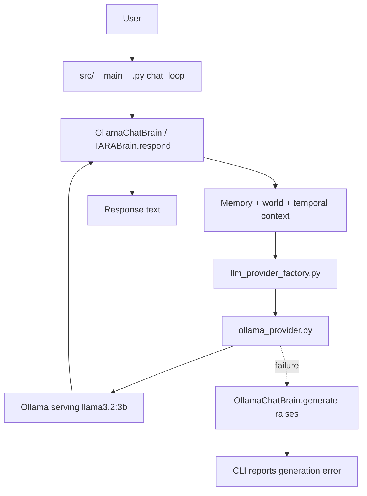

# Llama Connection: Deep File Cleanup Audit

**Audit date:** 2026-10-14  
**Audit target:** TARA's Llama/Ollama-enabled chat architecture and its surrounding training/research repository.  
**Baseline inspected:** `feature/tara-self-developer-v1`, reported head `804798f25a35c2c907ed6a9bbeeace5637739de2`; cross-checked against the current branch's source files, tests, README and repository searches.  
**Status:** Static dependency/reference audit. No files deleted. No local full test suite was run as part of this audit.

## Executive result

**Do not bulk-delete TARA's custom language-model files just because Ollama/Llama now answers chat messages.** Llama replaces the *default language-generation engine for the Ollama-enabled chat entry point*; it does not replace TARA's model-training research, algorithm checkpoint runtime, teacher-distillation pipeline, tests, benchmarks, or all of TARA's cognitive modules.

The safest immediate cleanup candidates are small and conditional:
1. **Review-only candidate:** `src/basic_brain.py` and `tests/test_basic_brain.py` — repository search found the class referenced by its own test, with no production import found. It appears to be an alternate baseline architecture. Remove only if that baseline/public compatibility surface is no longer wanted.
2. **Optional backend candidate:** `src/groq_provider.py`, `tests/test_groq_provider.py`, the `groq` dependency, and the unused `GroqProvider` import in `src/brain.py` — current `src/llm_provider_factory.py` selects Ollama or no provider; it does not select Groq. Keep these if a Groq/cloud backend is still a desired option; otherwise remove them as one tested change, not piecemeal.
3. **Independent housekeeping candidate:** `requirements-accelerated.txt` — it contains only `torch`, already listed in `requirements.txt`; no workflow/docs reference was found in the inspected source search. Confirm there is no personal setup workflow depending on it before removing.

**Files safe to delete solely because Llama was connected: none confirmed.** The three candidates above need product/compatibility confirmation and tests before deletion.

## What the live chat actually uses

The inspected path is:

- `src/__main__.py` sets the default backend to Ollama, obtains `provider_from_env()`, creates `OllamaChatBrain` with `model=None` and `tokenizer=None`, and routes user prompts through `brain.respond()`.
- `src/brain.py`'s `TARABrain.respond()` builds a prompt from retrieved memory, world context and temporal context, then calls `llm_provider.complete()` when a provider exists.
- `src/ollama_provider.py` sends a local `/api/chat` request using `llama3.2:3b` by default.
- `OllamaChatBrain.generate()` deliberately raises an error. So the chat entry point does **not** silently fall back to a trained TARA checkpoint if Ollama fails.
- This path does not itself prove that every planner, tool, safety, or verification subsystem runs for every answer. `respond()` currently constructs context and generates text; it does not visibly execute a full plan/tool/verification cycle before returning. That is an integration gap to test, not a reason to delete those modules.

## File disposition matrix

### A. Keep — directly part of Llama chat or teacher-data generation

| File | Why it remains |
|---|---|
| `src/__main__.py` | Interactive chat, memory commands, provider initialization and error reporting. |
| `src/brain.py` | TARA brain, memory/context composition, response interface and other cognitive APIs. |
| `src/llm_provider_factory.py` | Explicit environment-driven backend selection. |
| `src/ollama_provider.py` | Local Ollama HTTP adapter for the selected Llama model. |
| `src/memory.py` and the relevant context/world/temporal modules | Supply TARA-owned context; Llama does not replace persistence or application state. |
| `src/teacher_distillation.py` | Uses a text-provider contract to create provenance-marked candidate training examples from the teacher model. This is not chat inference, but it remains useful for TARA's learning path. |
| `tests/test_ollama_provider.py`, `tests/test_llm_provider_factory.py`, `tests/test_tara_cli.py`, `tests/test_teacher_distillation.py` | Regression coverage for provider behavior, CLI/memory commands and candidate-data generation. |
| `docs/local_llama.md`, `docs/tara_multi_domain_teacher_learning.md` | Setup and workflow documentation; retain and keep accurate. |

### B. Keep — not used by the Ollama chat path, but still referenced by TARA's research/runtime

These files may be unnecessary **for a minimal chat-only distribution**, but repository references show they are not globally obsolete.

| File/group | Evidence / role |
|---|---|
| `src/model_runtime.py` | Used by `TARABrain.from_checkpoint()`, `src/model_capability_runner.py`, and `src/polyglot/model_adapter.py`; loads a TARA checkpoint and generates algorithm-model output. |
| `src/torch_language_model.py` | `FastTinyLanguageModel` is used by checkpoint loading, training/benchmark code and model tests. |
| `src/language_model.py` | `TinyLanguageModel` / `SmallLanguageModel` are referenced by training scripts, experiments and tests. |
| `src/tokenizer.py` | `CharTokenizer` and `BPETokenizer` are used by training, experiments, Rust-tokenizer comparisons and tests. |
| `src/transformer.py`, `src/autograd.py`, `src/numeric_inference.py`, `src/embeddings.py`, `src/positional.py`, `src/initialization.py`, `src/generation.py`, `src/optimizers.py`, `src/layers.py`, `src/attention.py` | Components supporting TARA's own inspectable model implementation, numerical inference, training and experiments. Remove only if the custom-model research goal is explicitly retired and all downstream references are migrated. |
| `src/checkpoint.py`, `src/training*.py`, `src/targeted_training.py`, `src/training_dataset_mixer.py`, `src/language_dataset.py`, `src/text_dataset.py`, `src/dataset*.py`, `src/codeforces_corpus.py` | Training data, checkpointing, evaluation and learning workflows; Llama inference does not replace them. |
| Root `train_*.py`, `prepare_*.py`, `build_targeted_dataset.py`, `run_*experiment.py`, `experiments/*.py`, `rust-tokenizer/` | Training, evaluation, dataset and tokenizer experiments. The repository CI runs at least some of these paths; deleting them would change TARA's research scope. |
| `tests/test_language_model.py`, `tests/test_torch_language_model.py`, `tests/test_tokenizer.py`, training/benchmark/checkpoint tests | These tests protect the custom-model and experiment path, not the Ollama chat path. Do not remove tests merely to make a deletion pass. |

### C. Conditional cleanup candidates

#### C1. `src/basic_brain.py` + `tests/test_basic_brain.py`

**Observed:** The module defines a complete dependency-light alternative cognitive baseline. Search results found `BasicTARABrain` in the module and its own test; no production import was found in the inspected search.

**Recommendation:** Mark as *possibly legacy*, not confirmed dead. Before removal:
- decide whether this baseline is still useful for education, comparison or backwards compatibility;
- inspect exports/documented public API and branch history;
- if retired, remove the module and its test together and update docs/imports;
- run the full suite and a clean-install smoke test.

#### C2. `src/groq_provider.py` + `tests/test_groq_provider.py` + `groq` dependency

**Observed:** `GroqProvider` is defined and unit-tested, and `src/brain.py` imports it. The inspected `TARABrain` response path uses the injected `llm_provider`; the provider factory supports `ollama`/`llama` (both resolve to Ollama) or `none`, not Groq. The `GroqProvider` import appears unused in `src/brain.py`.

**Recommendation:** If TARA is intentionally local-only, a future cleanup can remove the unused import, provider module, its test, and `groq` dependency together. If cloud fallback/provider choice is planned, do not remove the module; wire it through an explicit factory option and test it. Never remove only the test to hide the unused status.

#### C3. `requirements-accelerated.txt`

**Observed:** It contains only `torch`, also present in `requirements.txt`; no usage was found in the inspected workflow/docs searches.

**Recommendation:** Low-risk housekeeping candidate after confirming no local setup instructions or personal scripts use it. This is unrelated to Llama integration.

### D. Do not remove on the basis of “Llama can answer now”

- `src/agent.py`, `src/advanced_planning.py`, `src/autonomous_orchestrator.py`, `src/unified_cognitive_loop.py`, `src/task_scheduler.py`, `src/task_resources.py`: planning and task state are TARA responsibilities, not model weights.
- `src/safety.py`, `src/tools/`, `src/sandbox_runner.py`, `src/self_developer.py`, `src/self_developer_cli.py`: permissions, host-tool interfaces, isolated candidate changes and review-gated development.
- `src/memory.py`, `src/cognitive_memory.py`, `src/world_state.py`, `src/temporal_perception.py`, `src/event_router.py`, `src/reflection.py`, `src/reflection_loop.py`: application state, temporal/world context and reflection.
- `src/elevenlabs_tts.py`: optional voice output, separate from text generation.
- `src/teacher_distillation.py` and its docs/tests: a teacher-data pipeline, not a duplicate chat runtime.

These modules still need runtime-wiring and capability tests; their presence alone does not prove that each is active in every turn.

## Dependency/behavior checks still required before any deletion

1. Run AST-based imports and repository-wide symbol/path searches on the exact candidate branch; include dynamic imports, CLI entry points, docs, workflows, packaging and external usage risk.
2. Capture a clean baseline: full `pytest -q`, `python -m src` chat smoke test with fake provider, teacher-data generation test, and model-checkpoint/polyglot smoke tests. Record real output, not assumptions.
3. Remove only one candidate group per commit. Re-run relevant tests and the full suite; compare import-time dependencies and cold-start behavior.
4. Check `requirements.txt` dependency necessity with import analysis and a clean install; do not drop `torch` while custom model/training/checkpoint paths remain.
5. Update README, setup docs, CI, and handoff only after the tests support the change.
6. Never delete user-local artifacts or model/checkpoint/data outputs as part of a source cleanup.

## Final verdict

**Immediate deletion list: empty.**  
**First candidates for a human-approved cleanup PR:** (1) Groq provider group if Groq is no longer supported, (2) basic-brain baseline if it is officially retired, (3) unused accelerated requirements file after checking local workflows.  
**Keep the custom model/training stack** unless the project owner explicitly changes TARA from a research-first architecture into a chat-only Ollama wrapper.
