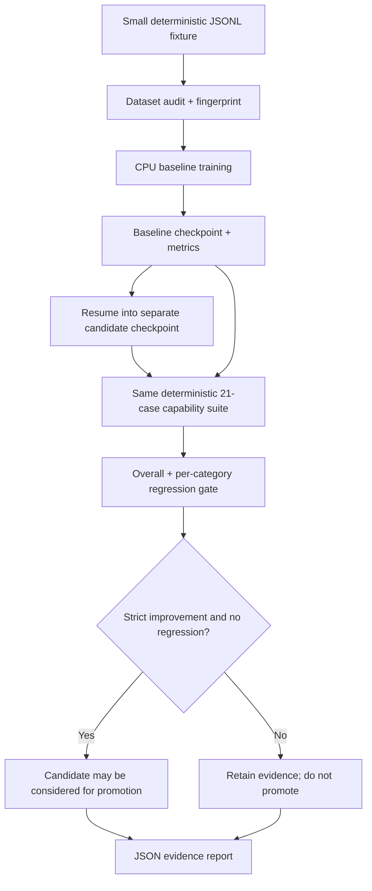

# Phase B — Intelligence Proof and Regression Gates

Phase B turns the existing training and evaluation components into an executable,
auditable proof path. It deliberately separates **pipeline success** from **model
capability improvement**.

## Evidence flow



The smoke runner never overwrites the baseline checkpoint and refuses to run when
its expected output filenames already exist. Choose a fresh output directory.

## Run on Windows CMD

From the repository root:

```bat
python -m pip install -r requirements.txt
python -m scripts.run_phase_b_smoke --output-dir artifacts\phase-b-smoke
python -m pytest tests\test_phase_b_smoke.py tests\test_learning_experiment.py tests\test_evaluation_orchestrator.py -q
```

The smoke run performs real, short CPU optimization steps, saves a baseline checkpoint,
resumes training into a separate candidate checkpoint, runs both through the same
21-case benchmark, and saves the gate decision. It uses a tiny synthetic fixture and
short decoding length to keep CI bounded. This is **not** the full Llama teacher/student
distillation run and is not evidence of broad intelligence.

## Evidence artifacts

| Artifact | What it establishes |
| --- | --- |
| `phase_b_dataset.jsonl` | Exact smoke dataset used |
| `baseline.pt`, `candidate.pt` | Distinct checkpoints; baseline is not overwritten |
| `*.metrics.jsonl` | Per-step train/validation measurements |
| `*.training.json` | Dataset audit/fingerprint, configuration and training summary |
| `learning_experiment.json` | Baseline/candidate benchmark, category deltas and gate decision |
| `phase_b_report.json` | Aggregated machine-readable run evidence |

The benchmark decision may reject the candidate. That is a valid smoke-test outcome:
the run proves that the gate executes, not that every candidate deserves promotion.
Use `--require-improvement` only when the intended job should fail unless the
candidate strictly improves and stays within all configured regression tolerances.

## What remains after this batch

- Run the full teacher/student distillation workload on the intended teacher, dataset,
  and available hardware; the smoke runner does not fetch a teacher model.
- Establish a recorded baseline from a real chosen checkpoint and retain its benchmark
  report before claiming capability deltas.
- Run Windows focused tests and the full Python/Rust suites on the exact branch head.
- Review evidence and approve integration explicitly; this batch does not merge any PR.

## CI contract

The dedicated GitHub Actions workflow runs only the bounded smoke path and its focused
tests, then uploads the report/checkpoints/metrics as an artifact. A passing job means
the workflow and regression gate executed; it does not mean the candidate passed the
improvement gate.


## Full reviewed-data experiment (separate from the smoke run)

After teacher-generated records have been reviewed and filtered, use the production experiment
runner with an existing baseline checkpoint and a **new** candidate path:

```bat
python -m scripts.run_phase_b_experiment checkpoints\baseline.pt data\llama_teacher_reviewed.jsonl checkpoints\phase_b_candidate.pt --steps 100 --device cpu
```

The baseline is evaluated first, then `TrainingExperiment` audits and trains from the supplied
reviewed dataset into a separate candidate checkpoint, then the same capability suite and
regression gate decide whether the candidate improved. Training configuration, data fingerprint,
step metrics, benchmark results, category deltas, and decision are retained as JSON evidence.
The command returns exit code 2 when the candidate fails to strictly improve; it still keeps the
candidate and report for diagnosis and never promotes or overwrites the baseline.

Do not use unreviewed teacher output as a trusted dataset. The smoke workflow uses synthetic data
only to prove the software path and cannot replace this real experiment.
