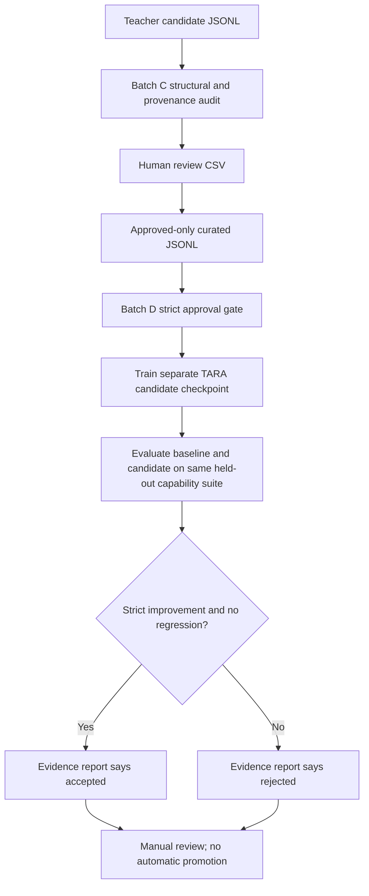

# TARA multi-domain teacher learning

TARA can use the local Ollama model as a teacher to create candidate training data across several capability areas, not only conversation memory. This is a data-generation stage in a larger teacher/student workflow.

## Domains in v1

- Mathematics
- Logical reasoning
- Python coding
- Algorithms and complexity
- Language and communication
- General scientific knowledge
- Planning
- Tool use and verification
- Safety and uncertainty

## Generate a small local sample

Ensure Ollama is running and the model is installed:

```bat
ollama list
python -m src.teacher_distillation --per-domain 2 --output outputs/llama_teacher_smoke.jsonl
```

The smoke command requests 18 candidate examples (2 for each of 9 domains). Increase `--per-domain` gradually. The default output is `data/llama_teacher_v1.jsonl`; the command refuses to overwrite an existing file unless `--overwrite` is explicitly provided.

## Review, then train

Each JSONL record includes the instruction, answer, domain, teacher model, SHA-256 fingerprint, and `review_status=unverified_candidate`. The `text` field is compatible with TARA's current text-dataset training interface.

Teacher-generated answers can be wrong, repetitive, or poorly reasoned. The generator only performs basic structural checks and exact-record deduplication; it does not prove factual or code correctness. Review/filter examples and evaluate on a separate held-out set before training.

After review, run TARA's existing explicit training workflow against a curated dataset and a separate candidate checkpoint, for example:

```bat
python run_training_experiment.py --data data/llama_teacher_reviewed.jsonl --output checkpoints/llama_teacher_candidate.pt --steps 100
```

The reviewed dataset path above is an example: create it from checked examples first. This command trains TARA's own model architecture; it does not change Llama's weights. To claim improvement, compare baseline and candidate on held-out capability tests and keep the candidate only if it passes the existing evaluation gate. Do not overwrite user checkpoints, personal conversation data, or experiment outputs.

## What this is and is not

- This pipeline uses Llama-generated answers as one teacher-data source; it does not access Llama's raw pretraining corpus.
- It complements public datasets, curated examples, verified tool outcomes, and user-approved conversation memory.
- Memory updates improve retrieved context. Model training updates a checkpoint. These are separate mechanisms.
- Large-scale teacher generation and training can consume substantial time, RAM, disk, and CPU/GPU resources; start small.


## Batch C: audit, review, and held-out evaluation

### 1. Audit candidate data (read-only)

```bat
python -m src.teacher_dataset_audit outputs\teacher_candidates.jsonl --report outputs\teacher_audit.json
```

The audit validates required fields, supported domain, non-empty content, canonical
text rendering, teacher provenance, review state, per-record SHA-256 fingerprint,
malformed JSON, duplicate fingerprints, and duplicate instruction/answer pairs. It
does not judge truth or executable-code correctness. Existing report paths are never
overwritten. Exit code 2 means an error was found (or a warning when
`--fail-on-warnings` is supplied).

### 2. Human review queue

```bat
python -m src.teacher_review export outputs\teacher_candidates.jsonl outputs\teacher_review.csv
```

Open the CSV in a spreadsheet editor. Check every answer against independent reasoning,
tests, or a trusted source; fill `decision` with exactly `approve` or `reject`, and
enter a reviewer identifier. Do not mark answers approved merely because they look fluent.

```bat
python -m src.teacher_review import outputs\teacher_candidates.jsonl outputs\teacher_review.csv data\teacher_approved.jsonl
```

Import requires one explicit decision per candidate and rejects changed answer text,
unknown/duplicate fingerprints, missing reviewers, invalid decisions, or pre-existing
output files. Only approved rows are emitted. The source candidate JSONL and review CSV
are read-only inputs to import.

### 3. Held-out checkpoint comparison

```bat
python -m src.teacher_heldout_eval checkpoints\baseline.pt checkpoints\phase_c_candidate.pt outputs\phase_c_heldout.json
```

The evaluator runs the same deterministic capability suite against both checkpoints and
records overall scores, per-category deltas, suite fingerprint, evaluation fingerprints,
and the strict regression-gate decision. Exit code 2 means the candidate was not accepted.
This fixed suite must be supplemented with task-specific tests that were not used in
teacher generation or training.

### Batch C handoff

- Candidate generation, audit, review, and held-out comparison are implemented in code.
- Generated answers are still untrusted until independently reviewed.
- No checkpoint is promoted, replaced, or deleted by these commands.
- CI, Windows focused tests, and full Python/Rust validation must pass before integration.


## Current handoff — 15 October 2026

- Branch: `feature/tara-phase-c-teacher-data-quality`
- Draft PR #16: https://github.com/deathkernel/TARA/pull/16 (stacked on Batch B PR #15).
- CI was queued at last check; exact-head CI must pass before this batch is considered validated:
  - https://github.com/deathkernel/TARA/actions/runs/38695774939
  - https://github.com/deathkernel/TARA/actions/runs/38695774821
- Next steps: inspect exact-head CI results, resolve any reproduced failures, run focused and full Python/Rust tests on Windows using a separate worktree, inspect diffs, and obtain explicit approval before merging.
- No local Windows suite or live teacher/model training was executed during remote repository edits.


### Batch C handoff update — 15 October 2026

PR #16 remains a draft stacked on Batch B PR #15: https://github.com/deathkernel/TARA/pull/16.
The branch is rebased onto the latest Batch B fix that runs experiment scripts as repository
modules, preserving that fix and its CI command. Exact-head CI, Windows tests, and the full Python/
Rust suites still need to pass before integration. No merge is performed without explicit approval.


## Batch D — approval-gated model learning

Batch D connects the reviewed teacher corpus to an explicit TARA candidate-training run.
It does not train Llama, silently train during chat, or promote checkpoints automatically.



### Run on Windows CMD

Use paths that do not already exist. Keep the baseline checkpoint read-only and choose a new candidate path.

```bat
python -m src.teacher_dataset_audit data\\teacher_approved.jsonl --report outputs\\teacher_approved_audit.json
python -m src.teacher_training data\\teacher_approved.jsonl checkpoints\\baseline.pt checkpoints\\batch_d_candidate.pt outputs\\batch_d_evidence.json --steps 100
```

The first command is optional preflight; the training command repeats the audit itself and blocks unless every row has `review_status=approved`, a review decision of `approve`, and a non-empty reviewer. Duplicate or structurally invalid data blocks training. Existing candidate/report paths are never overwritten. The candidate is a separate artifact even when the held-out gate rejects it; rejection never deletes it or promotes it.

The report records the dataset fingerprint and per-domain counts, training manifest, baseline/candidate evaluation, category deltas, decision, and report fingerprint. The gate requires a strict overall improvement and no disallowed category regression under the existing evaluator. This fixed capability suite is a regression signal only, not proof of general intelligence or correctness on every teacher example.

### Scope and validation status

- This is an explicit local training command; no training happens during chat/runtime startup.
- It trains TARA's own small language model, not Llama weights.
- Start with a small `--steps` value and monitor RAM, CPU/GPU, disk, and runtime.
- A generated candidate is not automatically the production checkpoint.
- Remote code edits do not establish that tests passed. Exact-head CI and Windows/full-suite validation must be checked separately.
