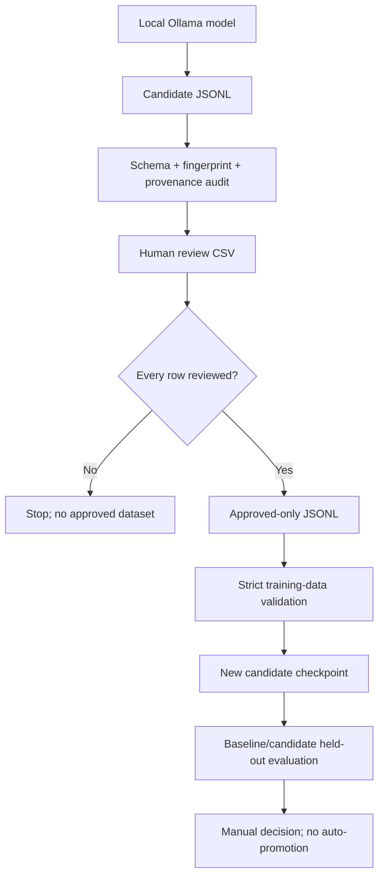

# Ollama-approved training-data migration and dependency audit

## Decision and safe scope

The default TARA student-training data path is now **Ollama-generated candidates that have passed structural/provenance audit and explicit human approval**. The default curated path is `data/teacher/approved.jsonl`. The repository intentionally does not contain a generated approved dataset; it must be created through the review workflow.

No existing dataset, checkpoint, output, conversation JSONL/manifest, or local working tree is deleted by this migration. The legacy sample and acquisition code remain in the branch for review and rollback. Destructive removal is a separate future decision after this migration is reviewed.

## Data flow



## Entry-point audit

| Entry point | New default/policy | Status |
|---|---|---|
| `src.teacher_pipeline prepare` | Ollama teacher generates candidate JSONL, audit report, review CSV, manifest | Preferred |
| `src.teacher_pipeline curate` | Writes approved-only JSONL from explicit reviewer decisions | Preferred |
| `src.teacher_pipeline train` | Requires approved data, baseline checkpoint, new candidate path, and evidence report | Preferred |
| `run_learning_experiment.py` | Requires approved teacher data; refuses existing candidate/manifest/metrics/report paths; `--allow-legacy-data` is explicit opt-in | Migrated |
| `run_training_experiment.py` | Defaults to approved teacher data; validates approval and refuses existing outputs; `--allow-legacy-data` is explicit opt-in | Migrated |
| `train_algorithm_lm.py` | Defaults to approved teacher data; legacy replay/targeted mixing requires explicit `--allow-legacy-data` | Migrated |
| `training_preflight.py` | Defaults to approved teacher data and blocks legacy/unreviewed input; `--allow-legacy-data` is explicit preflight-only opt-in | Migrated |
| `train_dataset.py`, `train_fast.py` | Public-corpus training is disabled by default; requires `--legacy-public-dataset` | Legacy research only |
| `data/algorithm_tasks.jsonl` | Retained as a historical sample; no longer a default for the main training/preflight CLIs | Archived in place |
| `data/dataset_sources.json`, `src/dataset_registry.py`, `src/dataset_acquisition.py`, `src/text_dataset.py`, `prepare_tara_dataset.py` | Retained for reproducible public-corpus experiments, not the preferred training path | Legacy research only |
| `train_tiny_lm.py` and small synthetic experiments | Tiny educational corpora/experiments, not the Ollama teacher production path | Retained |

## Dependency audit

- **PyTorch (`torch`)** remains required to train TARA's student model.
- **Ollama teacher generation** uses TARA's configured local provider; this migration does not require changing Ollama's installed model or its weights.
- **`datasets`** is an optional-at-runtime dependency for the legacy public-dataset registry and fallback path; the approved teacher JSONL pipeline does not need it to audit, curate, or train local JSONL.
- **`pyarrow`** is used by the legacy Codeforces Parquet ingestion and its tests, not by the Ollama teacher-data lifecycle.
- The two legacy dependencies remain listed in `requirements.txt` for now so existing public-dataset/Codeforces utilities and tests are not silently broken. They are annotated as legacy-only instead of being removed during the data migration.
- Other existing dependencies are retained because they support unrelated TARA runtime, provider, and test paths. This migration does not claim they are all required by the teacher pipeline.

## Provenance and safety rules

1. Teacher records must identify `source=ollama_teacher_generated`; unexpected source provenance is now a blocking audit error.
2. Every row used for training must have `review_status=approved`, `review.decision=approve`, and a non-empty `review.reviewer`.
3. Duplicate or structurally invalid teacher records block training.
4. Candidate checkpoints and reports must use new paths. Baselines remain read-only; no automatic promotion occurs.
5. A passing structural audit does not prove answer correctness. Independent review and held-out evaluation remain mandatory.
6. Do not clean/reset the original worktree or delete local `checkpoints/`, `outputs/`, `data/conversation_v1.jsonl`, its manifest, or `test_voice.py`.

## Validation handoff

Run from the repository root in Windows CMD, using a separate worktree for this branch:

```bat
python -m pytest tests/test_teacher_data_quality.py tests/test_teacher_training.py tests/test_teacher_pipeline.py tests/test_training_preflight.py -q
python -m pytest -q
python -m src.teacher_pipeline --help
cargo test --manifest-path rust-tokenizer/Cargo.toml
```

These commands are the validation plan, not a claim that tests have passed. Inspect the exact-head GitHub Actions and run Windows validation before merging. This migration is submitted as a separate draft PR and must remain unmerged until explicitly approved.
